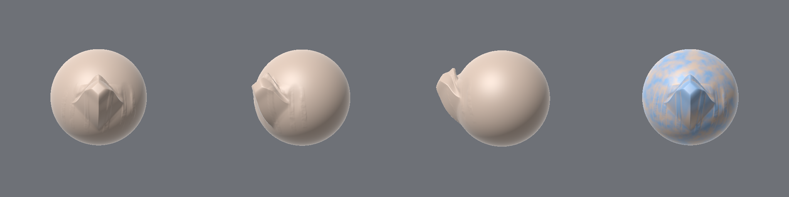

# Sculpt

A digital sculpting engine with Mudbox's workflow and ZBrush's density and brush
feel: sculpt layers with strength sliders and masks, freeze, Clay Buildup / Trim
Dynamic / Move / Smooth brushes, topological posing, Substance-style mask stacks
(procedural noise + hand painting + curvature/AO/thickness bakes) and a
data-driven layered project format.



*`sculpt-cli demo`: topological Move, Clay Buildup, Trim Dynamic and a posed bump; right panel shows the detail layer's mask (fbm noise ⊕ hand paint − cavity).*

See [`docs/ARCHITECTURE.md`](docs/ARCHITECTURE.md) for the design, measured
performance and roadmap.

```
crates/sculpt-core   engine library (no UI, no GPU dependency)
crates/sculpt-app    the desktop app: a layered volume sculptor, egui + wgpu, themeable
crates/sculpt-cli    demo / benchmark / project tools / thumbnail renderer
docs/                architecture, roadmap, screenshots
```

## The app

The app sculpts a **volume**: a distance field at several resolutions, so the surface never stretches. It has a
layer stack (the form, detail layers at their own resolutions, generator layers that scatter rocks, surface noise
drawn by the GPU), masks per layer, undo, and `.svol` files. The mesh engine and its project format live on in
`sculpt-core` and `sculpt-cli`; the app no longer sculpts meshes.

```sh
cargo run --release -p sculpt-app                          # a 1M-triangle ball
cargo run --release -p sculpt-app -- --triangles 3         # a 3M-triangle ball
cargo run --release -p sculpt-app -- path/to/rock.svol     # open a volume
cargo run --release -p sculpt-app -- --screenshot out.png  # save the window once the volume settles, then close
cargo run --release -p sculpt-app --features tablet        # + octotablet pen pressure (Windows Ink / Wayland)
SCULPT_DEMO_SCRIPT=gens cargo run --release -p sculpt-app -- --demo-volume frames/   # a scripted session, every frame saved
cargo run --release -p sculpt-app -- --gpu-levels-check    # the GPU surface against the CPU reference
```

| Input | Action |
|---|---|
| LMB drag | sculpt with the current brush (Clay Buildup adds, Trim Dynamic carves) |
| Ctrl + stroke | the other way: Clay Buildup carves, Trim Dynamic adds |
| Alt + LMB, or RMB drag | orbit |
| Alt + MMB, or MMB drag | pan |
| Alt + RMB drag, or wheel | zoom |
| `1` `2` | Clay Buildup, Trim Dynamic |
| `[` `]` / Shift+`[` `]` | brush size / strength |
| `F` frame · `H` engine readout · `Ctrl+Z` / `Ctrl+Shift+Z` undo / redo · `Ctrl+S` / `Ctrl+O` save / open | |

The layout: a context toolbar (brush, size, strength, falloff, and what strokes edit), **LAYERS** on the right
(click a layer to sculpt it, its **Hide / Show** to paint its mask, **Form** to sculpt the shape under every layer;
**+ Layer** or the **Volume** menu adds generator, surface noise and detail layers), **PROPERTIES** under it (the
selected layer's name, resolution, visibility and mask, a generator's or noise's settings, then the brush), and the
brush tray with a Falloff tab at the bottom. **Display** holds the level-of-detail settings.

Themes are JSON files (built-ins in `crates/sculpt-app/themes/`; your own go in `~/.config/sculpt/themes/` and
hot-reload on save, or use *Theme ▸ Theme editor*), and hotkeys are overridden per command in
`~/.config/sculpt/keymap.json` (same format as `crates/sculpt-app/keymap.json`; entries for commands the app no
longer has are skipped). Set `SCULPT_HOME` to relocate the config folder. The UI font is
[Inter](https://rsms.me/inter/) (SIL Open Font License 1.1, bundled in `crates/sculpt-app/assets/fonts/` with its
license).

## Build & run

```sh
cargo test --release                       # engine tests
cargo run --release -p sculpt-cli -- demo out   # scripted session -> out/demo.sculpt, OBJs, demo.png
cargo run --release -p sculpt-cli -- bench 9    # brush latency at 1.5M faces (10 = 6.3M)
cargo run --release -p sculpt-cli -- info out/demo.sculpt
cargo run --release -p sculpt-cli -- render out/demo.sculpt out/view.png
cargo run --release -p sculpt-cli -- import-channel out/demo.sculpt paint.ext values.csv
```

## Using the engine

```rust
use sculpt_core::{Document, brush::{self, BrushSettings, ClayBuildup}, primitives::quad_sphere};
use sculpt_core::mask::{MaskStack, MaskLayer, MaskSource};
use sculpt_core::noise::NoiseParams;

let mut doc = Document::from_mesh(quad_sphere(6, 1.0))?;
let detail = doc.add_layer("Detail");                       // becomes the active layer
brush::stroke(&mut doc, &mut ClayBuildup::default(), &BrushSettings::default(), &path)?;
doc.set_layer_opacity(detail, 0.6)?;                        // strength slider
doc.set_layer_mask(detail, Some(MaskStack::new(0.0)
    .with(MaskLayer::new("noise", MaskSource::Noise(NoiseParams::default())))))?;
sculpt_core::io::project::save(&doc, "head.sculpt".as_ref())?;
```
