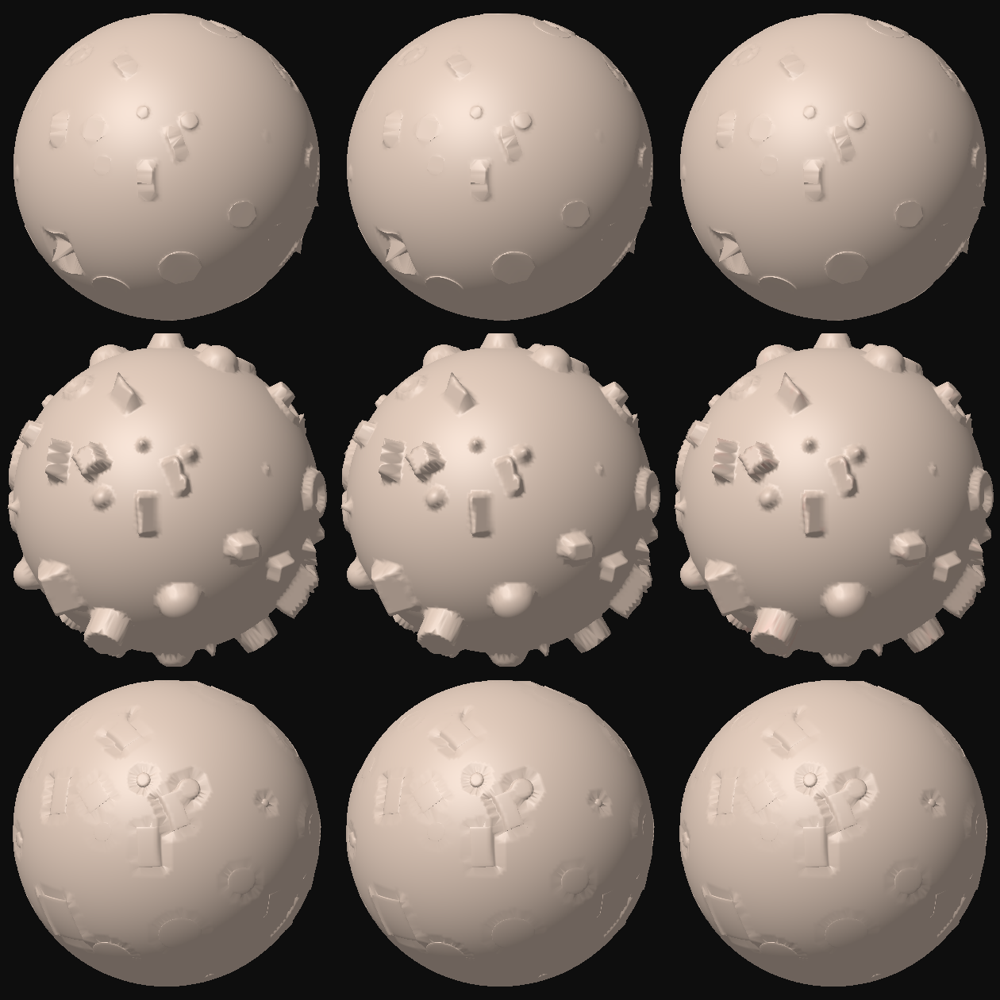

# Spike 1: GPU compute displacement boolean

Question: can the displacement boolean (spike A in `spike_results.md`) run as a wgpu compute shader so a
slider drag with up to 100k instances on a ~6M face mesh is interactive?

**Answer: the port is correct and the pipeline works end to end, but this container cannot show the speed.**
It only has a software Vulkan adapter (llvmpipe, i.e. the CPU), so every timing below is a CPU number.
They prove the shader does the right thing and give an operation count to extrapolate from, nothing more.
**Run the one-command benchmark below on a real GPU before deciding.** My recommendation is at the end.

## What was built

All in `crates/sculpt-app/src/gpu_boolean/` (the CPU path and the sculpt latency path are untouched):

| File | Role |
|---|---|
| `boolean.wgsl` | WGSL port of `generator/{sdf,instances,mod}.rs`: 7 analytic primitives, subtract / add / intersect with the same projection rules, grid build, leaf culling, per-vertex eval |
| `mod.rs` | `GpuBoolean` (pipelines, buffers, timestamps), `headless()` device, the CPU-vs-GPU unit test |
| `bench.rs` | headless benchmark, correctness comparison, PNG renderer |

`main.rs` gets one early-return branch: `sculpt-app --gpu-bench ...` runs before eframe, so no window is created.

### Data flow (one command buffer, three compute passes)

```
CPU (rayon)                         GPU
Instance[] --bake--> 128 B/inst --> insts (storage)
 + grid origin/cell/dims, per-instance cell range, entry count
                                    pass 1  clear_heads, build_grid : dense uniform grid of linked lists
                                            (one atomicAdd + atomicExchange per instance/cell pair)
                                    pass 2  mark_leaves : 1 workgroup per BVH leaf; leaf bounds vs occupied
                                            cells; appends active leaf ids; count = indirect dispatch x
                                    pass 3  clear_delta, eval : dispatch_indirect (active leaves, chunks/leaf),
                                            1 thread per owned vertex -> delta[v] = new - old
```

* **Instances**: transform columns, inverse scale, min scale, inflated AABB, grid cell range, primitive id and
  the uniform-sphere flag, 128 B each (100k = 12.8 MB). Baked on the CPU with rayon.
* **Grid**: dense, cell = mean instance extent (same rule as the CPU hash), cell size grown until the grid has
  at most 16.7M cells (67 MB). Built on the GPU as per-cell linked lists, so no prefix sum is needed. The CPU
  only computes the per-instance cell ranges (also giving the exact entry count for the pool).
  Order inside a cell is nondeterministic (atomics); the CPU sorts. This only matters for exact ties.
* **Mesh buffer**: 16 B per vertex, position (f32 x3) + normal as octahedral 2 x snorm16. A 24 B layout does not
  fit 6.3M vertices under the 128 MiB default `max_storage_buffer_binding_size` (llvmpipe and some
  integrated GPUs report that), 16 B does (100.7 MB). The quantisation only affects Add (it moves along the
  normal): at most 0.2% of an edge length. Positions and normals are uploaded once per topology, not per slider tick.
* **Per-vertex rules** are the CPU rules: subtract = project onto the most-penetrating cutter, up to 3 iterations,
  with the Lipschitz horizon prune (first 16 candidates cached in registers, re-walk of the cell if there are more);
  intersect = pull-in within `reach`; add = sphere-traced ray along the normal with 8-step bisection (exit point
  if inside, entry point within `reach` if outside). Same tetrahedral gradient for the non-box, non-sphere primitives.
* **Output**: a separate `delta` buffer (12 B/vertex), zeroed each run. `GpuBoolean::delta_buffer()` can be bound
  by a vertex shader to add it to the base positions with no CPU readback; `read_delta()` copies it back
  (tests, drag end, undo).
* **Leaf dispatch**: indirect dispatch over only the leaves whose bounds touch an occupied cell. Per-vertex there is
  also an early-out when the vertex's cell is empty.
* **Timing**: per-pass timestamp queries when the device supports them (it does on llvmpipe), plus wall time from
  submit to fence-wait return. CPU-side bake and `write_buffer` + submit-and-wait ("upload") are timed separately.

## Environment of the measurements

* Container, 4 cores, **no GPU**. Adapter: `llvmpipe (LLVM 20.1.2, 256 bits) | Cpu | Vulkan`, Mesa 25.2.8.
* **The host was busy** (load average 13 to 17 on 4 cores while these ran), so every number is noisy and the
  CPU generator is about 2x slower than in `spike_results.md` (`generator-bench 9 100000` gave 563 ms for the
  boolean in the same session versus 180 to 280 ms there). Use ratios within a table, not absolute values.
* **llvmpipe runs the shader as CPU code on the same 4 cores. These timings are NOT representative of a real GPU.**
  The "CPU ms" column is the existing rayon generator (`InstanceSet::new` + `evaluate`) timed in the same process.
* Meshes: quad sphere levels 7/8/9/10 = 98,304 / 393,216 / 1,572,864 / 6,291,456 faces (verts = faces + 2).
  Instances: sphere cutters on the surface at sampler points, diameter 3 to 10 edge lengths, as in `generator-bench`.
  Subtract, 3 iterations. Median of 3 reps after a warm-up. Every rep rebuilds from scratch (bake, upload, grid,
  cull, eval), which is the "every instance changes" slider case.

## Commands

```
cd sculpt
cargo build --release --workspace
cargo clippy --release --workspace --all-targets          # no warnings from gpu_boolean (1 pre-existing in sculpt-core tests)
cargo test --release --workspace                          # includes gpu_boolean::tests::gpu_matches_cpu (skips with no adapter)

# the tables below (spheres, subtract, plus a CPU column):
./target/release/sculpt-app --gpu-bench 7,8,9,10 1000,10000,100000 --reps 3 --cpu
# mixed primitives, all three ops:
./target/release/sculpt-app --gpu-bench 8,10 10000 --mixed --op all --reps 3 --cpu
# GPU vs CPU diff at every size:
./target/release/sculpt-app --gpu-bench 7,8 1000,10000 --mixed --op all --reps 1 --check
# the PNG:
./target/release/sculpt-app --gpu-bench --png docs/generator/spike1_gpu_compute.png
```

`--gpu-bench [LEVELS] [COUNTS] [--op subtract|add|intersect|all] [--mixed] [--reps N] [--cpu] [--check] [--png FILE]`.
Defaults: levels 7,8,9,10, counts 1000,10000,100000, subtract, spheres, 5 reps.

## Results (llvmpipe, i.e. CPU; not GPU timings)

Columns: `bake` = CPU instance bake + grid sizing, `upload` = `write_buffer` + submit/wait, `grid` / `cull` / `eval` =
timestamp queries of the three passes (`eval` includes clearing the delta buffer), `wall` = submit to fence
wait, `total` = bake + upload + wall (what a slider tick costs end to end), `leaves` = active / total leaves
dispatched, `CPU` = existing rayon generator in the same process (includes its hash rebuild).

| faces | instances | bake | upload | grid | cull | eval | wall | total | leaves | CPU |
|---|---|---|---|---|---|---|---|---|---|---|
| 98k | 1k | 0.15 | 0.14 | 0.42 | 0.32 | 7.34 | 8.66 | 8.95 | 64/64 | 9.0 |
| 98k | 10k | 1.08 | 0.55 | 4.11 | 0.33 | 41.13 | 48.04 | 49.68 | 64/64 | 44.3 |
| 98k | 100k | 10.09 | 4.24 | 53.38 | 0.39 | 475.59 | 529.94 | 544.27 | 64/64 | 341.8 |
| 393k | 1k | 0.21 | 0.13 | 0.58 | 0.95 | 17.56 | 19.50 | 19.85 | 256/256 | 21.2 |
| 393k | 10k | 0.89 | 0.45 | 12.48 | 0.96 | 78.99 | 93.42 | 94.75 | 256/256 | 67.9 |
| 393k | 100k | 11.19 | 11.73 | 43.81 | 1.70 | 598.31 | 636.91 | 659.83 | 256/256 | 372.0 |
| 1.57M | 1k | 0.11 | 0.08 | 3.58 | 4.02 | 79.25 | 87.00 | 87.19 | 946/1024 | 34.1 |
| 1.57M | 10k | 0.81 | 0.47 | 5.55 | 5.85 | 218.56 | 236.74 | 238.03 | 1024/1024 | 119.5 |
| 1.57M | 100k | 10.56 | 4.44 | 45.88 | 9.59 | 729.14 | 823.76 | 838.76 | 1024/1024 | 746.8 |
| 6.29M | 1k | 0.18 | 0.21 | 21.97 | 35.97 | 210.78 | 277.70 | 278.08 | 1685/4096 | 84.0 |
| 6.29M | 10k | 1.23 | 0.62 | 28.58 | 31.80 | 652.41 | 747.23 | 749.08 | 4093/4096 | 297.4 |
| 6.29M | 100k | 9.75 | 4.64 | 77.77 | 41.11 | 1683.51 | 1818.03 | 1832.42 | 4096/4096 | 1394.6 |

Mixed primitives (all 7, random non-uniform scale), 10k instances, all ops:

| faces | op | bake | upload | grid | cull | eval | wall | total | CPU |
|---|---|---|---|---|---|---|---|---|---|
| 393k | subtract | 0.91 | 0.58 | 2.35 | 1.14 | 281.59 | 285.86 | 287.36 | 188.0 |
| 393k | add | 0.88 | 0.44 | 10.60 | 0.71 | 395.56 | 401.16 | 402.47 | 364.2 |
| 393k | intersect | 4.33 | 0.48 | 10.33 | 0.63 | 463.07 | 475.71 | 480.52 | 415.5 |
| 6.29M | subtract | 1.45 | 0.68 | 24.64 | 17.52 | 785.60 | 853.73 | 855.86 | 348.0 |
| 6.29M | add | 0.93 | 0.56 | 9.87 | 14.53 | 1016.73 | 1042.09 | 1043.59 | 583.8 |
| 6.29M | intersect | 0.84 | 0.41 | 9.05 | 15.24 | 779.80 | 806.95 | 808.19 | 687.8 |

One-time costs at 6.29M verts: mesh upload 438 to 484 ms (100.7 MB mesh + zeroed delta), 244 MB of GPU buffers held.

What the llvmpipe numbers do tell us:

* They sit at 0.3x to 1.1x of the CPU generator. That is what you expect from a CPU running the same algorithm
  as SIMD code with atomics and pointer-chasing; it says nothing about a GPU.
* `eval` dominates everywhere. Instance bake (CPU, rayon) is about 10 ms at 100k instances; upload of 12.8 MB is
  4 ms here and about 1 ms over PCIe. Grid and cull cost almost nothing apart from clearing the up to 10.6M-cell
  head table (22 to 78 ms on llvmpipe, a 42 MB memset-class write on a GPU).
* The cull pass is weak at 1k instances: leaf bounds are coarse (2048 faces, a bounding box around a curved
  patch), so 1685 of 4096 leaves are dispatched at 6.3M faces/1k instances although only 1000 instances exist.
  The per-vertex empty-cell early-out catches the rest, but a per-64-vertex-chunk cull would be tighter.

## Correctness: GPU vs CPU generator

Unit test `gpu_boolean::tests::gpu_matches_cpu`: 6,144-face sphere (6,146 verts, 4 leaves), 150 mixed-primitive
instances (all 7 primitives, non-uniform scale), all three ops, per-vertex delta compared with
`sculpt_core::generator::evaluate`. Asserts the grid entry count equals the CPU-computed capacity, at least
99.9% of vertices within 0.3% of an edge, and max error under 1% of an edge. It skips with a message if no
adapter exists. Result on llvmpipe (edge length 0.0452):

| op | verts moved CPU / GPU | max delta | max error | mean error |
|---|---|---|---|---|
| subtract | 3209 / 3209 | 0.2017 | 9.6e-6 | 8.1e-8 |
| add | 3255 / 3255 | 0.2248 | 8.2e-5 | 2.3e-6 |
| intersect | 2631 / 2631 | 0.1143 | 8.7e-6 | 1.3e-7 |

`--check` on bigger meshes (mixed primitives; edge 0.0113 at 98k faces, 0.00565 at 393k):

| faces | N | op | moved CPU / GPU | max error | verts over 0.1 edge |
|---|---|---|---|---|---|
| 98k | 1k | subtract | 22872 / 22872 | 3.9e-6 | 0 |
| 98k | 1k | add | 22975 / 22975 | 5.6e-5 | 0 |
| 98k | 1k | intersect | 39030 / 39030 | 3.4e-6 | 0 |
| 98k | 10k | subtract | 94044 / 94044 | **1.1e-2** | **3** |
| 98k | 10k | add | 94115 / 94115 | 6.1e-5 | 0 |
| 98k | 10k | intersect | 4261 / 4261 | 1.2e-6 | 0 |
| 393k | 1k | subtract | 24444 / 24444 | 3.0e-5 | 0 |
| 393k | 1k | add | 24521 / 24521 | 4.1e-5 | 0 |
| 393k | 1k | intersect | 54681 / 54681 | 1.6e-6 | 0 |
| 393k | 10k | subtract | 200581 / 200581 | 6.5e-5 | 0 |
| 393k | 10k | add | 200987 / 200987 | 5.9e-5 | 0 |
| 393k | 10k | intersect | 170604 / 170604 | 1.6e-6 | 0 |

The moved-vertex counts are identical in every row. Errors are float noise (about 1e-5; the tetrahedral gradient
amplifies rounding by 1e-3 differences) plus the Add normal quantisation (up to 8e-5 absolute). The one outlier:
**3 vertices out of 98k with 10k overlapping cutters** differ by up to 1.1e-2 (about 1 edge length). That is a
discontinuity of the rule itself: with overlapping cutters, "most-penetrating instance" can flip between two
near-equal distances, and the GPU's cell order (atomics) differs from the CPU's sorted order, so the projection
lands on the other, equally valid, cutter surface. It is not a port bug, but it means GPU results are not bit-
reproducible and the projection has real ties in dense overlap. Mitigation if it matters: sort each cell list or
break ties by instance id.

Headless picture (`spike1_gpu_compute.png`, 24,578 verts, 60 mixed cutters, rows subtract / add / intersect,
columns CPU result / GPU result / GPU result tinted red by |GPU - CPU| with full red at 1% of an edge; no red
anywhere): `docs/generator/spike1_gpu_compute.png`.



## Run it on your machine

One command, any OS with Vulkan, Metal or DX12 (needs a Rust toolchain; no window opens):

```
cd sculpt && cargo run --release -p sculpt-app -- --gpu-bench 7,8,9,10 1000,10000,100000 --reps 5 --cpu
```

* Windows PowerShell and macOS / Linux shells use the same line. First build takes a few minutes (eframe).
* The first line printed is the adapter (`name | DiscreteGpu/IntegratedGpu/Cpu | Vulkan/Metal/Dx12`). If it says `Cpu`
  you are on a software driver and the numbers mean nothing.
* Force a backend with `WGPU_BACKEND=vulkan|metal|dx12` (the adapter is the high-performance one, so a laptop with two GPUs uses the discrete one).
* Add `--op all --mixed` for add / intersect and non-uniform mixed primitives, `--check` for the GPU vs CPU diff.
* The 6.29M row needs about 250 MB of GPU memory and several GB of host RAM for the mesh build (the CPU mesh is built
  first, 8 to 14 s here). Drop `10` from the levels on small machines.
* The number to read is **`total`** (bake + upload + wall) per row. Drag-interactive is roughly `total` under 16 to 33 ms.
  `eval` is the part that scales with the GPU.
* If timestamp queries are not supported the program prints it and the `grid / cull / eval` columns show `n/a`;
  use `wall`.

## Extrapolation to real GPUs (reasoning, not measurement)

Work per run at 6.29M verts, 100k instances (cells hold about 4 candidates each, as measured: 858k entries over
roughly 200k occupied surface cells):

* **Bandwidth floor**: mesh read 100 MB, delta clear 75 MB, delta write 75 MB, head-table clear up to 42 MB, plus
  instance and entry gathers that mostly hit cache (12.8 MB instances, 6.9 MB entries): roughly 300 MB. At 68 GB/s
  (M1 / Iris Xe class) that is 4.5 ms; at 250 to 900 GB/s (discrete) it is 0.3 to 1.2 ms. For 10k instances the
  same. Bandwidth is not the limit.
* **ALU**: each vertex does the cell lookup, about 4 AABB tests, 1 to 2 SDF evaluations (a sphere is a length and a
  subtract; a box, torus or the tetrahedral gradient of a wedge or cone is 4 to 5 SDFs), then up to two more projection
  iterations. I estimate 300 to 600 flops per vertex on this data, so 2 to 4 GFLOP for the full mesh. Branchy,
  divergent, with dependent loads, a kernel like this typically reaches 10 to 25% of peak FP32.

| GPU class | peak FP32 | effective at 10 to 25% | eval, 6.3M verts, 100k inst | eval, 6.3M verts, 10k inst |
|---|---|---|---|---|
| Intel Iris Xe / similar iGPU | ~2 TFLOPs | 0.2 to 0.5 | 4 to 20 ms | 1 to 5 ms |
| Apple M1 / M2 | 2.6 to 3.6 TFLOPs | 0.3 to 0.9 | 3 to 13 ms | 1 to 4 ms |
| RTX 3060 / RX 6700 class | 12 to 13 TFLOPs | 1.2 to 3 | 1 to 3 ms | 0.3 to 1 ms |
| RTX 4070 and up | 29 TFLOPs+ | 3 to 7 | 0.5 to 1.5 ms | under 0.5 ms |

(10k-instance rows scale the flops by the candidate count, about 10x fewer per vertex in the grid cell; the
measured CPU eval ratio 10k : 100k is about 1 : 4 to 1 : 5, so I use that rather than 1 : 10.)

Adding the other steps measured above (bake about 10 ms at 100k on 4 busy CPU cores, grid build about 1 ms, upload about
1 ms, head clear about 1 ms), the estimate for a full-mesh slider tick:

* 6.3M faces, 100k instances: **about 15 to 35 ms on a mid-range discrete GPU or Apple Silicon, 15 to 40 ms on an
  iGPU if the bake is moved to the GPU** (bake is the largest remaining CPU piece; it is 128 B per instance of simple
  matrix math and fits a trivial compute pass, which would bring 100k down to about 1 ms).
* 6.3M faces, 10k instances: **about 3 to 10 ms** (CPU spike: 58 ms).
* 1.6M faces and below: well under 10 ms at every instance count except 100k on an iGPU.

Cross-check against the CPU generator: it needs ~280 ms at 100k / 6.3M on 4 quiet cores (about 50 GFLOP/s sustained at
this branchiness). A GPU with 20 to 100x the usable throughput gives 3 to 14 ms. Both approaches agree on single-digit to
low tens of milliseconds, so I expect 100k instances to be interactive on discrete GPUs and borderline-to-comfortable on
integrated ones. Treat that as a hypothesis until the command above is run.

Caveats that can change it: if the head-table clear or the 1 to 2 SDF-per-candidate guess is wrong by 3x, the
iGPU numbers move into 30 to 60 ms. Dense overlap (many cutters per cell) raises per-vertex work linearly. The
timestamp numbers on a discrete GPU exclude the driver's submit latency (0.1 to 0.5 ms).

## Costs and risks of integrating this

* **Memory**: GPU holds a second copy of the mesh (16 B/vertex, 100 MB at 6.3M) plus delta (75 MB) plus grid (up to
  67 MB). The viewport already holds positions and normals; the viewport shader could read the same buffer if it adopts
  the packed layout, or the delta buffer can be added in the existing vertex shader.
* **Limits**: single storage bindings must stay under `max_storage_buffer_binding_size` (128 MiB default; the app already
  raises it to the adapter maximum). The 16 B layout fits 8.3M vertices under 128 MiB; beyond that split into pages or
  rely on the raised limit. 8 storage buffers per stage is exactly the default; there is no headroom for more bindings
  without raising that limit.
* **Dense grid** is capped at 16.7M cells; very sparse, widely scattered instances get a coarser cell and more
  candidates per cell. A sparse hash on the GPU would fix that at some cost.
* **Layer order**: the generator is a function layer, so lower-layer edits change the input positions. The GPU mesh copy
  must be refreshed when lower layers change (75 to 100 MB at 6.3M faces, fine for a sculpt stroke end, not per frame
  during sculpting), or sculpt-time positions must already live on the GPU.
* **Undo, export, save** need CPU data: read the delta back once at the end of a drag (75 MB at 6.3M, tens of ms).
* **Ties** (above) make GPU output non-reproducible only where cutters overlap with near-equal distances.
* **Fallback**: no adapter, or software adapter, falls back to the existing CPU path (the unit test already shows the
  skip pattern). Do not ship software Vulkan as the live path: llvmpipe is slower than the CPU generator here.

## Recommendation

1. **Adopt the GPU compute path as the live (drag) evaluator for the Generator Boolean layer, behind a hardware-adapter
   check, and keep the CPU generator as reference, fallback and the source for undo/export/bake.** The algorithm ports
   directly: results match the CPU to float noise on every op and primitive, the design (CPU bake, GPU grid, GPU leaf cull,
   indirect dispatch) works, and the bandwidth and ALU numbers say a real GPU should clear 100k instances at 6M faces.
2. **Before committing the schedule, run the benchmark on one discrete GPU and one integrated or Apple GPU** (one command
   above). Go if `total` at 6.3M / 100k is under about 33 ms on the integrated one and under 16 ms on the discrete one;
   if the integrated one is above 60 ms, ship the GPU path as optional and keep CPU interactive up to 10k instances
   (CPU spike: 58 ms at 6.3M).
3. **Follow-ups if it passes**: move the instance bake into a compute pass, cull per 64-vertex chunk instead of per leaf,
   sort or tie-break cell lists by instance id for determinism, and have the viewport vertex shader add `delta` to the
   base positions so a drag never reads back.
4. **Not recommended**: using this as a reason to drop the CPU path. The hybrid in `spike_results.md` (live displacement,
   explicit voxel Apply) is unchanged; this spike only changes what "live" can mean at high instance counts.
