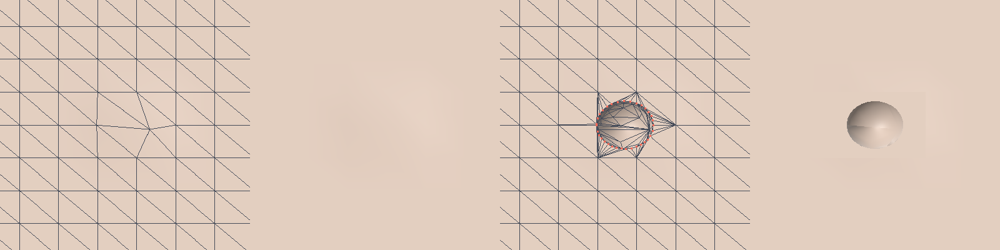
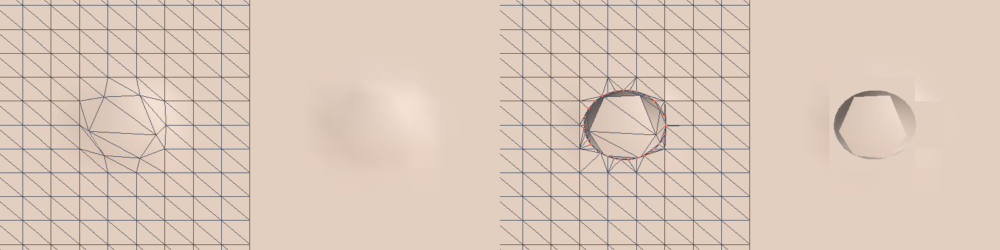
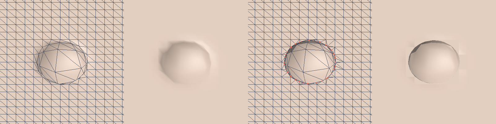
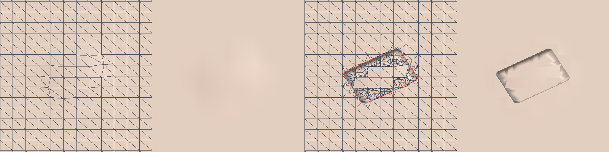
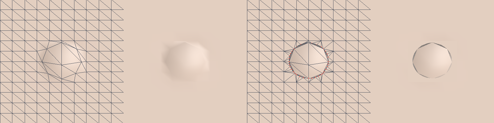
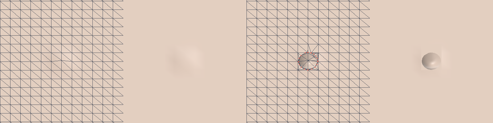
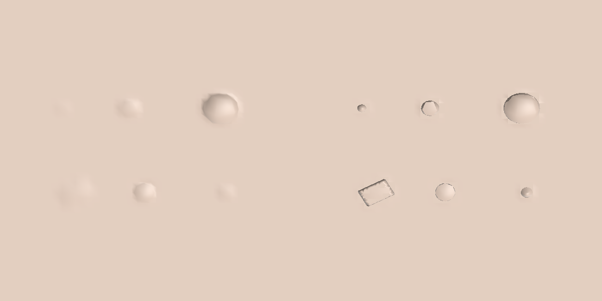
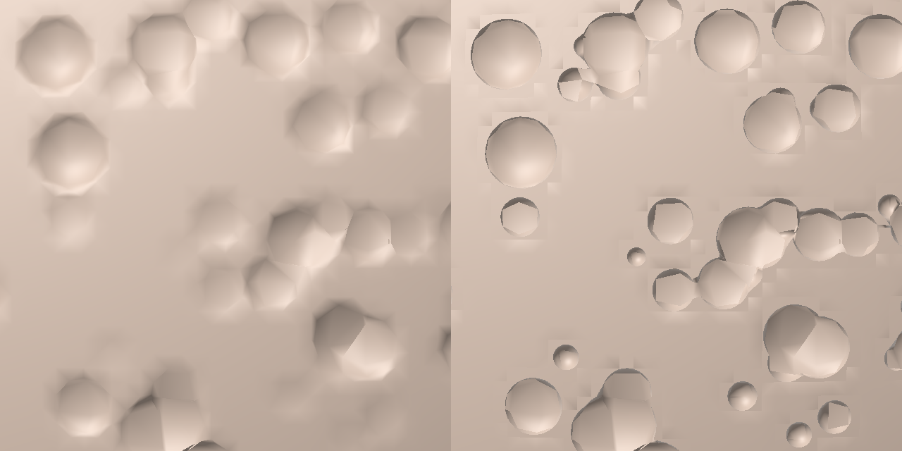
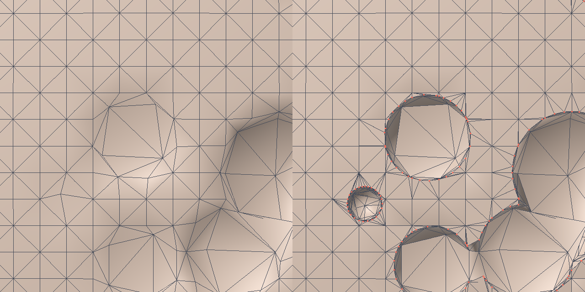

# Spike 3: adaptive boundary refinement for the displacement boolean

Code: `crates/sculpt-core/src/generator/refine.rs` (new), CLI: `sculpt-cli refine-bench`
(`crates/sculpt-cli/src/refine_bench.rs`, `render_mesh.rs`), tests: `crates/sculpt-core/tests/refine.rs`.
Context: `DESIGN.md`, `spike_results.md` (spike A = per-vertex displacement boolean).

## TL;DR

* **Crisp boundaries work.** On a flat region with sphere cutters 1.5, 3 and 6 mesh edges across, the rim
  vertices lie on the true intersection circle to float tolerance (max 2e-4 edge), and the rim polyline
  (chords between those vertices) is within 0.008 / 0.017 / 0.033 edge (median) of the circle. Spike A's
  rim is 0.3-0.4 edge off on average and up to ~1 edge off (it is a one-edge-wide ramp), at 98k and at 1.6M
  faces alike (the result is a function of cutter size in mesh edges, not of the face count).
* **The patch is local and crack-free.** Only the ring of faces around a rim enters a patch (about 5, 11 and 23
  base faces for 1.5, 3 and 6 edge cutters; 80-160 triangles after refinement). Patches of different
  leaves are bit-identical on shared edges; base + patches is a closed, consistently oriented manifold on
  98k and 393k face spheres, spheres and all 7 primitives (0 boundary / non-manifold / flipped edges).
  A control with a naive "leaves skip their border faces" policy gives 1534 open edges, so the check bites.
* **It does not keep A's speed.** The cost is proportional to the rim faces, not to the mesh, but the constant
  is large: 0.1-0.2 ms of wall time (4 threads) per instance. 1k instances: 110-195 ms full at any mesh size,
  **2-20 ms for a 1% edit**. 10k instances: 0.8-1.8 s full, 60-970 ms for a 1% edit. Against spike A's full
  evaluation that is 1.3x (6.3M faces, where A has to touch every vertex of 1000+ leaves) to 70x (98k faces).
  Fine for edits and for 1k instances; a full recompute of 10k instances is a "settle" job, not a drag job.
* **Recommendation:** keep A (GPU or CPU) as the live drag preview, run refinement for the dirty leaves after the
  drag settles, draw the patches instead of the replaced faces, and use the same patches as the starting point of a
  commit (needs parent weights for attribute interpolation). Details at the end.

## What was built

Everything is a pure function of (mesh positions and normals, face list, leaf BVH, `InstanceSet`), per leaf, in
parallel. Output per touched leaf is a `RefinedPatch { positions, normals, indices, base_vertex, topo,
crease_edges, crease_vertices, replaced_faces, stats }`. It is a temporary draw object: the editable mesh is
never modified. Only **Subtract** is implemented (Add / Intersect are not).

1. **Find the faces, instance driven.** `InstanceSet::candidates_in_box(leaf bounds)` gives the instances of a leaf,
   `Leaf::faces_overlapping(instance AABB)` (new, queries the fine ray tree that already exists) gives the faces
   near them. No pass over the leaf's 2048 faces and no pass over the mesh. A face joins the patch if it has a
   vertex inside a cutter and at least one outside, or an original mesh edge whose middle is inside while both
   ends are outside ("dip", a cutter smaller than an edge). Faces with all vertices inside are **left to A**
   (A moves them exactly), so the patch is a ring, not the whole crater.
2. **Refine in original space** with edge splits and 1/2/3-edge templates (bisection, "2 marked" = triangle plus
   split quad, red). A vertex is `Out`, `In` or `Crease` (on the zero set, within tolerance):
   * An edge from `Out` to `In` is split **at the zero crossing**: secant/bisection on the union SDF (typically
     under 10 evaluations), the new vertex is `Crease`.
   * An edge interior to a source face (the quad diagonal and everything the templates create) that separates a
     surface triangle from a wall triangle is a rim edge. It is split at the midpoint and the vertex is **snapped
     onto the intersection curve**: Newton on the SDF restricted to the tangent plane (plane through the point
     with the interpolated surface normal). Rim edges are split until shorter than `crease_frac` (0.3) times
     the cutter's smallest half size. Wall edges (both sides wall) are split until `wall_frac` (0.5) times that.
   * Dips are split in the middle; the two halves then straddle and get exact crossings on the next pass.
   * Triangles settle once no edge of theirs (and no interior neighbour) is marked; later passes only touch the
     rim, so cost follows the rim.
3. **Displace.** `In` vertices use exactly spike A's `eval_vertex` (project onto the cutter, 3 iterations), base
   vertices additionally with A's `position + (q - position)` arithmetic. `Out` and `Crease` stay.
4. **Shade.** Surface vertices carry the interpolated base normal, wall vertices the negated SDF gradient, and a
   `Crease` vertex exists twice (same position, `topo` id shared) so the rim has a hard normal break.
   `crease_edges` / `crease_vertices` list the rim for overlays and metrics.

`compose()` and `check_closed()` (same file) build base-minus-replaced-plus-patches as one triangle soup and weld it
by bit-exact position to test closedness; they are O(mesh) tools, not part of the timed path.
Minimal touches to existing code: `Leaf::faces_overlapping` (bvh.rs), `InstanceSet::candidates_in_box`
(instances.rs), `pub mod refine` (mod.rs), the `refine-bench` subcommand (cli main.rs).

### Commands

```
cd sculpt
cargo build --release --workspace
cargo test  --release -p sculpt-core --test refine          # 8 tests
cargo clippy --release --workspace --all-targets
./target/release/sculpt-cli refine-bench quality 98000,1600000 1.5,3,6   # table (a), patch sizes (c)
./target/release/sculpt-cli refine-bench time 7,8,9,10 1000,10000        # table (b), 3-10 edge cutters
./target/release/sculpt-cli refine-bench time 7,8,9,10 1000,10000 --small  # 1.5-4 edge cutters
./target/release/sculpt-cli refine-bench cracks 7 1000                   # closedness; --mixed, --naive
./target/release/sculpt-cli refine-bench dump docs/generator/img         # PNG (+ OBJ) of A vs refined
# overrides for any of them: --crease=0.3 --wall=0.5 --levels=6
```

## (a) Boundary quality

Setup: flat quad grid (edge 0.01) with 16x16 sphere cutters on a lattice (12 edges apart, random sub-edge offset, centre
height c uniform in [0, 0.5 R] above the plane, so the true intersection is the circle of radius sqrt(R^2 - c^2) in
the plane). Only cutters whose AABB lies in one BVH leaf are counted (146-213 per row), so the whole rim is in one patch.
All distances are in mesh edges (1.0 = one edge).

* *boundary vertex dev*: distance of boundary vertices to the true circle. Spike A has no vertex on the curve; its
  boundary is the outer ring (unmoved vertices next to moved ones, on the plane) plus the inner ring (outermost
  moved vertices, on the cutter), measured at the positions they are drawn at. Refined: the `Crease` vertices.
* *Hausdorff*: max(farthest boundary vertex from the circle, farthest of 360 circle samples from the nearest
  boundary vertex) for the vertex rows. "rim polyline" uses the rim edges instead of just vertices (so chord
  error is included: that is what a viewer sees); it has no analogue for A, whose ramp edges cross the circle.

| faces | cutter dia (edges) | method | cutters measured | dev mean | dev max | Hausdorff median | Hausdorff p95 | Hausdorff max |
|---|---|---|---|---|---|---|---|---|
| 97,969 | 1.5 | A (no refinement) | 196 / 196 | 0.386 | 0.992 | 0.830 | 0.963 | 0.992 |
| 97,969 | 1.5 | refined, rim vertices | 196 / 196 | 0.0000 | 0.0002 | 0.105 | 0.111 | 0.201 |
| 97,969 | 1.5 | refined, rim polyline | 196 / 196 | 0.0092 | 0.167 | 0.0080 | 0.0094 | 0.201 |
| 97,969 | 3 | A (no refinement) | 196 / 196 | 0.350 | 0.990 | 0.873 | 0.980 | 0.990 |
| 97,969 | 3 | refined, rim vertices | 196 / 196 | 0.0000 | 0.0001 | 0.211 | 0.223 | 0.225 |
| 97,969 | 3 | refined, rim polyline | 196 / 196 | 0.0166 | 0.075 | 0.0164 | 0.0193 | 0.211 |
| 97,969 | 6 | A (no refinement) | 146 / 146 | 0.320 | 0.998 | 0.900 | 0.981 | 0.998 |
| 97,969 | 6 | refined, rim vertices | 146 / 146 | 0.0000 | 0.0001 | 0.414 | 0.443 | 0.497 |
| 97,969 | 6 | refined, rim polyline | 146 / 146 | 0.0344 | 0.087 | 0.0327 | 0.0548 | 0.485 |
| 1,600,225 | 1.5 | A (no refinement) | 213 / 213 | 0.385 | 0.999 | 0.825 | 0.963 | 0.999 |
| 1,600,225 | 1.5 | refined, rim vertices | 213 / 213 | 0.0000 | 0.0001 | 0.105 | 0.111 | 0.201 |
| 1,600,225 | 1.5 | refined, rim polyline | 213 / 213 | 0.0091 | 0.167 | 0.0080 | 0.0094 | 0.201 |
| 1,600,225 | 3 | A (no refinement) | 182 / 182 | 0.349 | 0.990 | 0.871 | 0.977 | 0.990 |
| 1,600,225 | 3 | refined, rim vertices | 182 / 182 | 0.0000 | 0.0002 | 0.211 | 0.223 | 0.225 |
| 1,600,225 | 3 | refined, rim polyline | 182 / 182 | 0.0167 | 0.075 | 0.0165 | 0.0192 | 0.210 |
| 1,600,225 | 6 | A (no refinement) | 144 / 144 | 0.320 | 0.998 | 0.899 | 0.981 | 0.998 |
| 1,600,225 | 6 | refined, rim vertices | 144 / 144 | 0.0000 | 0.0001 | 0.414 | 0.443 | 0.497 |
| 1,600,225 | 6 | refined, rim polyline | 144 / 144 | 0.0344 | 0.087 | 0.0327 | 0.0548 | 0.485 |

Reading it:

* Refined rim vertices sit on the curve to the classification tolerance (`max(2e-5 * cutter size, 1e-6 * (1 + |x|))`
  absolute, i.e. at most 2e-4 edge here). The vertex-only Hausdorff is just the vertex spacing: the rim has about
  21 vertices per circle (spacing 0.3 R), so half the spacing: 0.1 / 0.2 / 0.4 edge for the three sizes.
* What a viewer sees is the polyline, whose error is the chord sag: **0.008 / 0.017 / 0.033 edge median**, p95 up to
  0.055. The sag is proportional to `crease_frac^2 * R`; `--crease=0.15` measured 4x smaller (median 0.0021 / 0.0041 / 0.0085) for 1.3-1.5x the triangles (221 / 165 / 177 per cutter).
* The polyline "Hausdorff max" (0.2-0.5) comes from a handful of cutters per row (3 of 196/146 in the cases
  inspected), all of one kind: the circle passes within ~0.01 edge of a grid line (the lattice makes cardinal
  tangent cases likely), so the rim runs along an existing mesh edge through non-rim vertices and the rim-edge
  list has a gap there (consecutive rim vertices 0.8-1.0 edge apart with no listed edge between them). The
  worst chord sag among the listed rim edges is 0.075-0.17 edge (`dev max` of the polyline rows; 0.17 is a 1.5-edge
  cutter that hit the 6-pass cap), so that statistic overstates the error, but a rim that is only 5-10 vertices per
  circle in such spots is real.
* Spike A: nothing is lost at these sizes in this setup (every cutter moves at least one vertex), but the result is
  a dimple whose edge is a 1-edge ramp; the 1.5-edge cutter is almost invisible (images below).
* 98k and 1.6M faces give the same numbers to the third digit, as expected: the algorithm only sees local
  geometry, so quality is a function of cutter size in mesh edges.

## (b) Time

Machine: container with **4 cores shared with other jobs (load average about 14 during these runs)**. Absolute times
are inflated and noisy, up to 2-3x (spike A's own full evaluation at 6.3M faces and 10k instances ranged from
156 to 468 ms across runs); ratios within one table are more reliable than values across tables. Medians of 3
(full) and 6 (1% edit) runs after a warm-up. Instances are spheres on the surface of a quad sphere at the generator-bench
levels (7 = 98k ... 10 = 6.3M faces), centre 0.15 diameters above the surface, random orientation; `tris after`
counts the patch triangles of the whole scene.

* *A full*: spike A `evaluate` over all leaves. *refine full*: `refine_all` (leaf lookup + all patches).
* *1% edit*: 1% of the instances grow by 1.3x: `InstanceSet::update` + `affected_leaves` of old and new AABBs +
  re-evaluate (A) or re-refine (refine) only those leaves, alternating changed/original state.

**Cutters 3-10 mesh edges across** (`refine-bench time 7,8,9,10 1000,10000`)

| faces | N | A full ms | refine full ms | leaves | base faces replaced | tris after | patch MB | A 1% ms | refine 1% ms | 1% leaves | 1% faces replaced |
|---|---|---|---|---|---|---|---|---|---|---|---|
| 98,304 | 1,000 | 16.2 | 109.1 | 64 | 19,301 | 118,688 | 4.3 | 3.02 | 20.34 | 12 | 3,710 |
| 98,304 | 10,000 | 47.1 | 77.5 | 64 | 1,483 | 9,636 | 0.3 | 33.93 | 60.17 | 64 | 1,424 |
| 393,216 | 1,000 | 19.7 | 120.3 | 256 | 24,313 | 148,250 | 5.3 | 4.88 | 16.31 | 14 | 1,600 |
| 393,216 | 10,000 | 97.3 | 832.6 | 256 | 105,578 | 655,468 | 23.2 | 44.36 | 407.35 | 129 | 52,832 |
| 1,572,864 | 1,000 | 59.9 | 130.6 | 875 | 25,318 | 154,104 | 5.6 | 1.54 | 2.98 | 14 | 568 |
| 1,572,864 | 10,000 | 160.3 | 1248.1 | 1024 | 222,044 | 1,355,002 | 48.8 | 29.57 | 220.07 | 160 | 35,492 |
| 6,291,456 | 1,000 | 140.1 | 184.0 | 1317 | 25,509 | 155,114 | 5.6 | 1.68 | 2.32 | 19 | 411 |
| 6,291,456 | 10,000 | 429.0 | 1595.7 | 4079 | 249,915 | 1,518,650 | 54.8 | 40.94 | 102.02 | 165 | 11,016 |

(98k faces with 10,000 cutters of 3-10 edges: the cutters cover nearly the whole sphere, so almost every face is
"all inside" and left to A; only the 1,483-face ring remains. That row is saturation, not a speedup.)

**Cutters 1.5-4 mesh edges across** (`--small`)

| faces | N | A full ms | refine full ms | leaves | base faces replaced | tris after | patch MB | A 1% ms | refine 1% ms | 1% leaves | 1% faces replaced |
|---|---|---|---|---|---|---|---|---|---|---|---|
| 98,304 | 1,000 | 5.4 | 147.4 | 64 | 10,258 | 135,520 | 4.3 | 1.38 | 11.03 | 11 | 1,841 |
| 98,304 | 10,000 | 17.0 | 1136.3 | 64 | 54,876 | 881,670 | 26.9 | 28.84 | 969.61 | 60 | 51,328 |
| 393,216 | 1,000 | 25.8 | 194.5 | 256 | 10,581 | 138,496 | 4.4 | 1.23 | 10.98 | 11 | 576 |
| 393,216 | 10,000 | 63.7 | 1285.1 | 256 | 95,931 | 1,300,352 | 40.9 | 35.59 | 567.85 | 98 | 36,847 |
| 1,572,864 | 1,000 | 72.0 | 166.7 | 805 | 10,635 | 139,248 | 4.4 | 1.16 | 2.46 | 11 | 211 |
| 1,572,864 | 10,000 | 150.5 | 1573.3 | 1024 | 104,719 | 1,378,998 | 43.7 | 25.32 | 220.97 | 122 | 13,053 |
| 6,291,456 | 1,000 | 140.0 | 194.4 | 1136 | 10,616 | 139,100 | 4.4 | 1.12 | 1.87 | 12 | 145 |
| 6,291,456 | 10,000 | 468.2 | 1833.3 | 4030 | 106,181 | 1,389,712 | 44.1 | 36.97 | 67.60 | 121 | 3,642 |

What it says:

* Cost follows the rim, not the mesh: with 1k instances the patch is 4-6 MB and 120-190 ms from 98k to 6.3M faces
  (the growth at 6.3M is cache misses on the big arrays; A grows the same way, 5 -> 140 ms). Per instance that
  is about 0.15 ms of wall time, 0.6 ms of CPU, for about 100-150 output triangles.
* A 1% edit at 1k instances (10 cutters): **1.9-20 ms**. At 10k instances (100 cutters): 60-970 ms; the low end is
  large meshes where the 100 cutters live in 120 leaves, the high end is the 98k mesh where they all hit the same
  64 leaves (and the triangle budget is 880k).
* A full refine of 10k instances is 1.1-1.8 s (small cutters) and 0.8-1.6 s (large, ignoring the saturated 98k row),
  4-70x A's full evaluation (A is mesh-size dependent, refinement is not). Not a drag-time operation; it is a
  settle-time operation, in the background.
* Time is roughly linear in output triangles (about 1 us per output triangle per pass level): `--levels=0/1/2/6`
  gave 80 / 250 / 510 / 1010 ms on 10k small cutters at 98k faces. `--wall=1.0` gives 69-80 instead of 110-160
  triangles per small cutter (and about half the time in `quality`: 16-33 ms vs 21-48 ms for 256 cutters, noisy) at the
  cost of occasionally coarser rims (see failure modes).

## (c) Patch size and watertightness

Per cutter (256 sphere cutters on the flat grid, same triangles at 98k and 1.6M faces):

| cutter dia (edges) | base faces replaced | triangles before | triangles after | added | new vertices | pass levels (max) |
|---|---|---|---|---|---|---|
| 1.5 | 5.4 | 10.8 | 161.7 | 151.0 | 75.9 | 6 (cap hit) |
| 3 | 11.3 | 22.6 | 109.8 | 87.2 | 44.1 | 4 |
| 6 | 22.9 | 45.8 | 134.9 | 89.0 | 45.5 | 2 |

Added faces are about 90 per cutter above 3 edges and 150 for 1.5 edges (the small one pays for the crater floor:
the cap needs interior vertices that the mesh does not have). Scenes: 135k triangles for 1k small cutters, 1.4M for
10k, about 4-5 MB per 1k cutters of position+normal+index data.

**Cracks.** Three kinds were met, all detected by the same test: weld the composed mesh (base with A's delta applied,
minus replaced faces, plus patches) by exact position and require every undirected edge to have two triangles and
no directed edge twice.

1. *T-junctions at leaf (and patch) borders.* A leaf only sees its own faces, so any decision that looks at a
   triangle (closure of marks, "refine while any neighbour is refined", per-leaf size fields) can split an edge on one
   side and not on the other. Control experiment (`RefineParams::debug_skip_leaf_borders`, `cracks --naive`: leaves leave
   their border faces to the base): **1534 open edges** on 98k faces and 1000 cutters.
   *Stitching = no stitching pass, the rules are pure.* (i) A split of an original mesh edge or of any of its
   descendants is a function of the two end positions only, with the ends put in a canonical order (bitwise
   position order, not vertex id), so every leaf computes the identical vertex (crossing by bisection/secant, or a
   plain midpoint with the same `normalize(n_a + n_b)` normal). (ii) The decision to split such an edge uses only
   its two ends and the SDF (straddles, or dips) - never the triangles around it. (iii) A face is in a patch iff a
   function of its own vertices and edges says so, so the face across a split edge always joins the other
   leaf's patch (its AABB overlaps the instance, so the instance query finds it). (iv) Edges interior to a source face are
   free to use the two adjacent triangles (that is how rim edges are recognised), because those never cross leaves.
   Result: 796 / 722 / 3502 vertices (spheres / all primitives / 393k faces) are shared bit-identically between
   patches of different leaves, and the composed meshes are closed (0 boundary, 0 non-manifold, 0 flipped, 0 degenerate):

   | mesh | instances | leaves patched | base faces replaced | triangles after | closed |
   |---|---|---|---|---|---|
   | 98,304 faces | 1000 spheres 1.5-4 edges | 64 | 10,258 | 135,520 | yes |
   | 98,304 faces | 1000, all 7 primitives | 64 | 9,000 | 182,760 | yes |
   | 393,216 faces | 4000 spheres 1.5-4 edges | 256 | 41,461 | 545,928 | yes |
   | 98,304 faces, naive border policy | 1000 spheres | 64 | - | 121,764 | **no, 1534 open edges** |

2. *Last-bit mismatch between patch and base.* The base mesh is drawn with A's `position + delta`. A patch vertex that
   is a base vertex must have the same bits, or the weld shows an open edge (and a real hairline crack on the GPU is
   possible when positions differ by 1e-6 and a rasterization rule is unlucky). First version classified vertices with
   a tolerance (`In` = s < -tol) while A moves any vertex with s < 0, so vertices with s in [-tol, 0) were moved
   by A but not by the patch: a few open edges per thousand cutters. Fix: base vertices are always positioned by
   calling A's function with A's arithmetic (and `RefineParams::eval` must equal A's `EvalParams`). The stress test
   `no_cracks_dense_small_cutters_on_98k_faces` (3000 random plus 300 near-vertex cutters on 98k faces) found it.
3. *Collapsed triangles.* Not a crack, but the weld check also reports degenerate and non-manifold triangles if a
   cutter centre lies exactly on the surface (below).

## (d) Images

All images: `docs/generator/img/`. Close-ups on the flat region have four panels, left to right: **A with
wireframe, A shaded, refined with wireframe and rim vertices (red), refined shaded**. Shading uses vertex normals
(A: recomputed from the displaced mesh; refined: surface normal on the surface, SDF gradient on the wall, doubled
at the rim).

| size | image |
|---|---|
| 1.5 edges |  |
| 3 edges |  |
| 6 edges |  |
| box (rotated, 5 x 2.4 x 3.4 edges) |  |
| cylinder (tilted, 3.2 edges) |  |
| cone (5 edges) |  |

Overview of the flat scene (A left, refined right; top row spheres 1.5 / 3 / 6, bottom row box, cylinder, cone):



98k-face sphere, 70 cutters of 1.5-6 edges in front. A left, refined right:



Close-up with wireframe and rim vertices:



What to look at: the 1.5 and 3 edge cutters are a faint dimple and a polygonal bump in A and a round crater with a
sharp rim after refinement; the wireframe shows the rim triangles and the long thin "surface" triangles that connect
the rim to the untouched mesh.

## Failure modes

* **Cutter centre on or very near the surface.** Spike A's rule is a radial projection onto the cutter. With the
  centre in the surface plane the whole floor of a hemispherical crater projects onto the equator, so A already
  collapses it, and refinement (which adds vertices along the same rays) produces welded duplicates, degenerate and
  non-manifold triangles (seen with 300 cutters centred exactly on mesh vertices). Not fixed here; a normal-direction
  projection for the wall (as in "Add") would, but then A and the patch must change together. Centres at least ~0.15
  radius off the surface are fine; the benchmarks use 0 to 0.5 R above it.
* **Overlapping cutters.** The union SDF (min over instances) gives the right outer rim, but the crease where two walls
  meet is not snapped, and inside vertices project to one of the two surfaces: the wall-wall seams look crinkled in the
  sphere overview.
* **Near-tangent rims.** A rim running along a mesh edge (within about 0.01 edge) works, but the rim passes through non-rim
  vertices, so the rim-edge list has a gap and the coverage statistic is poor (table (a) maxima).
* **Cutters below about one edge.** A feature is only found if a vertex is inside or an edge's middle is inside. A cutter
  that sits inside one triangle without touching an edge midpoint is lost (as in A).
* **Triangle quality.** The 2-marked template and rim snapping make long thin "surface" triangles from the rim to the
  untouched mesh (visible spikes in the wireframes). They are geometrically correct and shaded correctly but poor for
  later smoothing or for committing without a cleanup. Min angle is not controlled.
* **Wall refinement tradeoff.** `wall_frac` 1.0 halves the triangles of small cutters but, when a thin surface triangle's
  centroid falls inside the cutter, the rim edge is classified wall-wall and kept longer than `crease_frac`; rim error
  then goes from 0.075 to 0.15 edge at 3-edge cutters. Default 0.5.
* **Non-spheres.** Boxes, cylinders and cones get exact crossings and snapped rims, but floors are shaded noisily: inside
  vertices project to the nearest face and normals come from a finite-difference SDF gradient (box picture). Hard
  inner edges of a box are not represented as creases.
* **Curved base mesh.** Rim snapping uses the plane through the point with the interpolated vertex normal, so the
  curve is on the mesh surface to O(edge^2 * curvature), not on the subdivision limit surface.
* **Only Subtract.** Add (heightfield along the normal) and Intersect have no refinement yet.
* **Cost.** About 100-160 triangles and ~0.15 ms per cutter; 10k cutters = 1.1-1.8 s full recompute. The edge budget
  (`max_tris`, `max_levels`) caps runaway work per leaf.
* **Tolerance contract.** Patch and base meet bit for bit only if the patch is built with A's exact parameters; any
  change to A's iteration count, reach or arithmetic must change `RefineParams::eval` with it.
* **Measurement noise.** Shared 4-core container at load ~14, see (b).

## Recommendation

**Keep A as the live path and add refinement as a settle-time stage.**

* *Drag / slider (GPU preview):* run A exactly as today (per-vertex delta, GPU or CPU; `spike_results.md` has 4-34 ms for
  up to 10k instances on an idle machine, 5-470 ms in the loaded runs above).
  Nothing in refinement is needed while parameters change; the rim is a ramp but it is fast and stable.
* *Settle (after ~100-200 ms without input):* run `refine_leaves(affected_leaves(dirty instance AABBs))` on a worker.
  For a 1% edit that is 2-20 ms at 1k instances and 60-970 ms at 10k (mostly 100-400), so a slider release costs a frame or two on
  normal scenes. Schedule a full `refine_all` only on open or on topology change (0.1-0.2 s per 1k instances,
  background). Cache patches per leaf and invalidate by the same dirty leaves A uses.
* *Drawing:* upload each patch as its own vertex/index buffer and hide `replaced_faces` of the base. The ramp triangles of
  A are not under the patch (they poke into the cutter), so a depth bias is not enough: either compact the touched
  leaf's index buffer without those faces (2048 faces per leaf, cheap, and the LOD tree already has per-leaf index
  ranges) or put a per-face hidden bit in a storage buffer. Fragment normals come from the patch, so the rim is hard
  without extra work. Faces fully inside a cutter need nothing: A draws them and the patch meets them bit for bit
  (requires the GPU path to reproduce A's float arithmetic for base vertices, or to read the CPU delta; otherwise use a
  small epsilon overlap and accept hairline gaps on the GPU).
* *Commit to real geometry:* a patch is already a valid mesh fragment with exact rim vertices, so commit = replace
  `replaced_faces` of the leaf by the patch (dynamic topology) and keep the leaf's A delta for untouched vertices. Three things are
  missing and cheap to add: (1) parent edge and parameter for every new vertex (`base_vertex` has the base ones) to
  interpolate masks, layer deltas and channels; (2) the `crease_edges` as a sharp-edge attribute so later smoothing does
  not round the rim; (3) a cleanup of the thin rim triangles (flip/collapse) and a denser wall (`--wall` small) at commit
  time, because the wall is only as dense as the preview needs. For overhangs, undercuts and cutters centred on the surface
  (where A's radial rule fails) the commit still needs spike B (voxel) as the fallback, as in the hybrid recommended in
  `spike_results.md`; this spike removes the main objection to A (jagged boundaries from mesh density) without B's cost for
  the common case of small cutters on a surface.
* *Next steps if this is adopted:* normal-direction wall projection in A and patch together (fixes the on-surface centre
  case and makes caps injective); a leaf-local instance list to speed up the probes; a cheaper rim classification to
  get below 0.1 ms per cutter; Add and Intersect.
