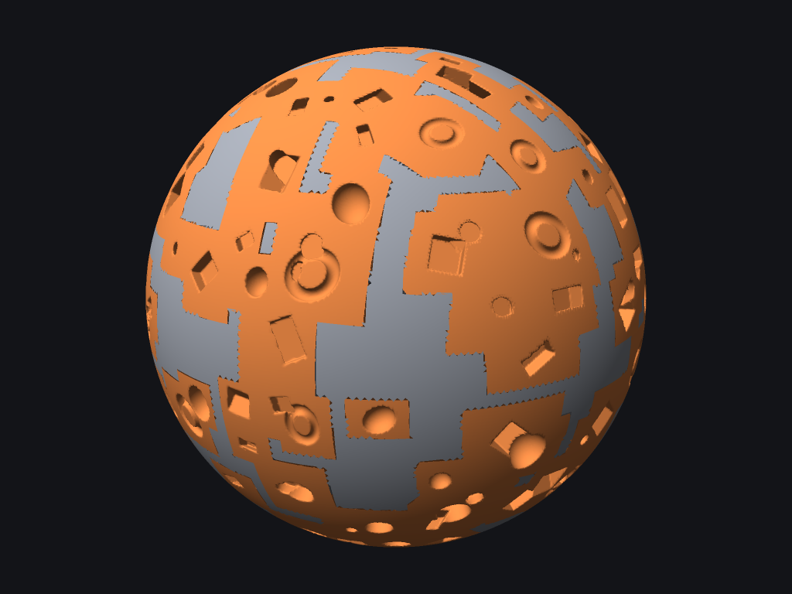
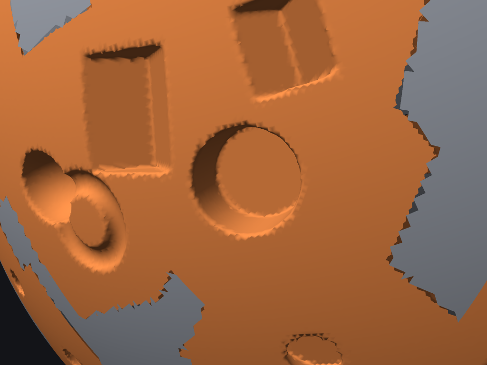
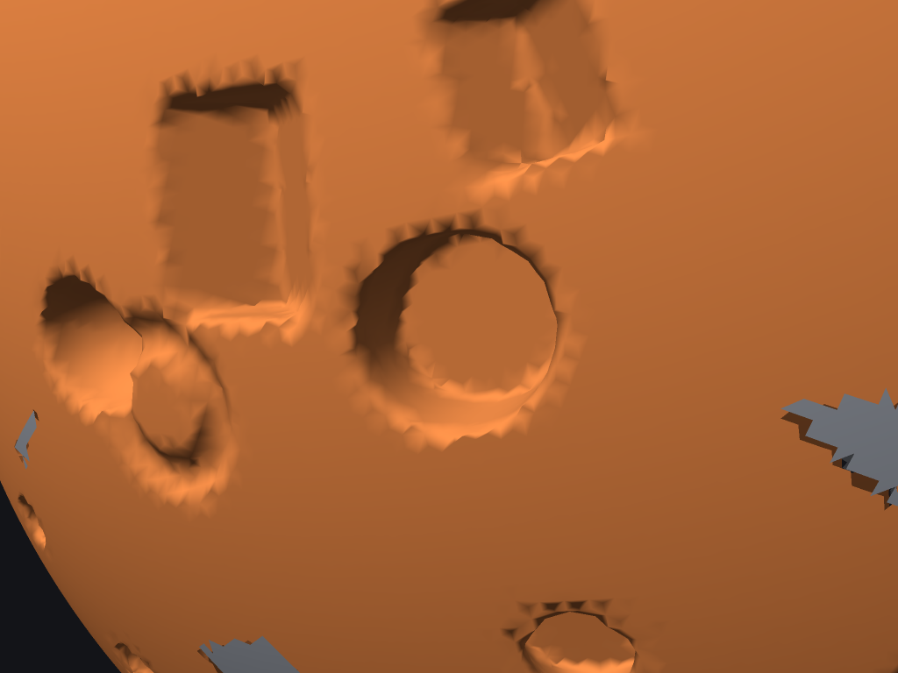
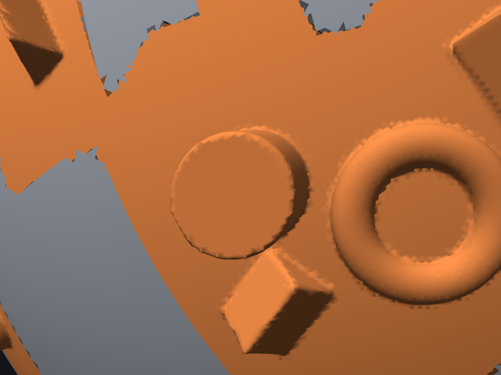
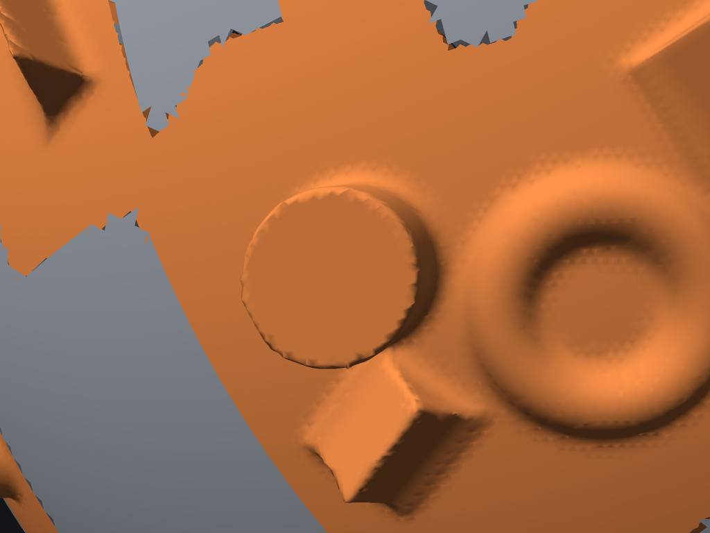
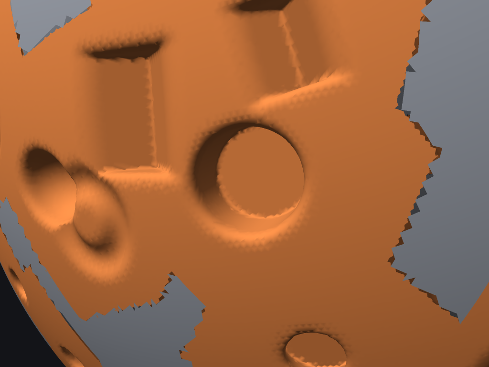

# Spike 5: GPU sparse-SDF boolean for the Generator Boolean layer

Question: does moving the true voxel/SDF boolean ("B" in `spike_results.md`) to the GPU make it interactive?
Code: `crates/sculpt-app/src/gpu_sdf/` (`mod.rs`, `sdf.wgsl`, `bench.rs`, `check.rs`, `render.rs`, `render.wgsl`), plus
`MeshSdf::flatten` / `pseudo_normals` in `sculpt-core` (`generator/voxel.rs`) so the GPU can use the same closest-point structure as the CPU code.
Everything runs on its own `wgpu` device with no window.

## TL;DR

* **It works and it is exact.** A GPU pipeline (hash-table brick cache of the mesh signed distance, per-brick instance lists, analytic-SDF combine, surface nets into append buffers) reproduces the CPU voxel code:
  the combined field matches to f32 rounding (max 0.005 voxel), every vertex matches an independent CPU surface-nets run, and every surface point is within **0.61 voxel** of the CPU boolean's zero set (mean 0.02-0.09).
  Subtract, union, intersect and smooth variants, all 7 primitives. It makes the things the displacement boolean A cannot: vertical walls, flat floors, overhangs, a torus with a hole through it (see Images).
* **I could not measure a GPU.** This container only has llvmpipe (software Vulkan on 4 shared CPU cores). Counts (bricks, vertices, memory, work per query) are exact; llvmpipe times are real but meaningless as GPU times
  (cold cache 8 s to 28 min, frame 0.2-61 s, extrapolated by brick count); real-GPU numbers below are a **model with an order-of-magnitude error bar** (calibrated against llvmpipe it is optimistic by 4-12x). One command
  (`cargo run --release -p sculpt-app -- --gpu-sdf-bench`) produces the real tables on Windows/macOS/Linux.
* **If the model is right** (mid discrete GPU, 12 Tflop/s): a warm frame (combine + extraction) is 1-4 ms at 1k instances, 4-37 ms at 10k, 40-210 ms at 100k, against 45 ms-14 s for the CPU spike's best case (mesh distance cached for free).
  The cold cache costs 0.05-2 s up to 10k instances and 0.05-6.8 s at 100k, against 1.9 s-5 min on the CPU. So the *arithmetic* is interactive up to about 10k instances; it is a 20-100x gain over the CPU.
* **But the output and the cache are the real cost**: 4 KB per brick at f32 means **20 MB to 6.4 GB** of cache and **9 MB to 3.5 GB** of overlay buffers (up to 102M triangles at 100k instances, voxel 0.5 edge, 6.3M faces), no LOD for the overlay,
  and on llvmpipe a 128 MB binding limit that already caps the cache at 33k bricks (a 3D texture atlas or f16 and paging are needed in production).
* **It does not compose with the editable per-vertex mesh.** The overlay has no vertex ids, layers, masks or undo. Replacing "touched leaves" means replacing the whole surface from about 10k instances (spike A: 43% of leaves at 1k, 100% at 10k),
  and brick-granular replacement leaves cracks. Bringing a result into the document is a **remesh event**: new topology, lost subdivision levels, flattened layers, full-snapshot undo, nearest-surface resampling of per-vertex data
  (measured 0.3-0.8 us per new vertex on 4 CPU threads, so seconds for 10M+ vertices; the same kernel on the GPU is the base-query rate).
* **Recommendation: commit-only (GPU-accelerated), plus an optional gated preview; do not make it the live evaluator.** Keep A live. Use the GPU pipeline as the "Apply as solid" engine (model: seconds instead of minutes for
  100k instances on 6.3M faces) and decide on a read-only true-boolean preview only after the one-command benchmark on a real GPU shows a warm frame of 16 ms or less at 1.6M faces, 10k instances, voxel 1 edge.

## Hardware caveat (read this first)

This container has **no GPU**. The only adapter is `llvmpipe` (Mesa's software Vulkan, 4 CPU cores, `DeviceType::Cpu`), shared with other jobs
(load average 6-9 during the runs; timings wobble by 2-3x between runs, so the benchmark reports the fastest of 5 frames, and cold stages are single measurements).
Everything below marked "llvmpipe" is real, measured behaviour of the code, but it is the speed of a CPU running a shader, not of a GPU.
It is useful for three things only: **correctness** (identical results to the CPU code), **counts** (bricks, vertices, memory, work per query: exact and hardware independent),
and **relative cost between stages**. Anything about real-GPU time is a model (see "Extrapolation") and is labelled as such. The model is checked
only against llvmpipe itself (calibration table below), never against a real GPU: run the one-command benchmark on your own machine and replace it.

## Commands

All commands run from the `sculpt/` workspace and use a window-less device (works over SSH; needs a Vulkan, Metal or DX12 driver; on Linux a software
Vulkan such as lavapipe also works but is slow).

```
cd sculpt

# 1. The benchmark you should run on your own machine (Windows, macOS, Linux). Prints markdown tables.
cargo run --release -p sculpt-app -- --gpu-sdf-bench > gpu_sdf_bench.md

#    Exact (no brick sampling) wherever the cache fits one storage binding of your adapter, all four mesh sizes:
cargo run --release -p sculpt-app -- --gpu-sdf-bench 7,8,9,10 1000,10000,100000 --max-bricks 0 > gpu_sdf_bench_exact.md

#    Options: [levels] [counts] --voxels 1,0.5 --max-bricks N --frames K --mixed --op subtract|union|intersect --smooth K --no-resample
#    (levels 7,8,9,10 = 98k / 393k / 1.6M / 6.3M faces; --voxels are multiples of the mean mesh edge length)

# 2. Correctness against the CPU voxel code (six op/voxel combinations, exits non-zero on mismatch)
cargo run --release -p sculpt-app -- --gpu-sdf-check

# 3. Images through the headless render path (offscreen colour + depth, PNG)
cargo run --release -p sculpt-app -- --gpu-sdf-png out_dir

# 4. Tests (skip with a message when there is no adapter)
cargo test --release -p sculpt-app gpu_sdf
```

First build compiles the whole egui/wgpu stack (a few minutes). The benchmark prints the adapter name on its first line and flags a software rasterizer.
If you post results, please include that line, `nproc`, and the "base queries/s" column, which is the single number the model below hinges on.

## What was built

### Design

```
 persistent cache (rebuilt only for bricks a lower layer touches)          per frame (an instance edit)
 ---------------------------------------------------------------          ------------------------------
 base mesh --flatten--> GPU BVH       hash table  brick key -> slot        upload instances (96 B each)
   (closest point + pseudo-normal     slot pool   10^3 f32 base SDF/brick  enum_insert / assign_slots   (new bricks only: base_classify + base_fill)
    sign, same as CPU spike B)                                              reset_heads / list_build     (per-brick instance lists, atomics, no sort)
                                                                            combine                      (base + analytic instance SDFs, min/max)
                                                                            verts_pass / indices_pass    (surface nets into append buffers)
                                                                            draw indexed from the append buffers
```

* **Bricks**: 8^3 voxels, stored as a **10^3 lattice** (one sample of padding on every side). With the pad, every vertex and quad of a brick can be
  computed from that brick alone, so extraction needs no neighbour lookups and the passes are embarrassingly parallel. Cost: 37% more samples than 9^3 and
  about 1.38x duplicate vertices on brick borders (counted separately below as "buffer" vs "owned").
* **Cache** (`enum_insert`, `assign_slots`, `base_classify`, `base_fill`): an open-addressing hash table on the GPU (`atomicCompareExchange` on a packed 3 x 10-bit key)
  maps brick to slot. Bricks are created lazily where instances need them, so the cache covers the instanced region, not the whole surface. `base_classify`
  does one unbounded closest-point query at the brick centre; `base_fill` then evaluates the signed distance at every lattice sample, with the search bounded by
  `|d_centre| + half-diagonal`. Bricks whose centre is farther than half a diagonal plus the band from the surface store the constant centre value (as spike B did).
  Signed distance = closest point on the triangle mesh, sign from angle-weighted vertex pseudo-normals (the CPU spike's rule, including its failure modes).
* **Instance binning** (`list_build`): each instance walks the bricks its inflated AABB overlaps and pushes itself onto a per-brick linked list with `atomicExchange`;
  the first instance to touch a brick in a frame (a frame stamp, `atomicMax`) appends it to the active list. No sort, no prefix sum.
* **Combine**: one invocation per lattice sample walks its brick's list: `m = min(sdf_i)` over instances whose inflated AABB contains the sample (same cull as the CPU),
  then `subtract = max(base, -m)`, `union = min(base, m)`, `intersect = max(base, m)`; optional polynomial smooth min/max between the base and the instance union
  (smoothing *between instances* is order dependent with atomic list order, so instances are combined with a hard min).
  All seven primitives are ported (box, sphere, cylinder, cone, wedge, chamfer cutter, torus) with the CPU's non-uniform-scale lower bound.
* **Extraction** (`verts_pass`, `indices_pass`): naive surface nets. A vertex per sign-changing cell (average of the edge crossings, normal from the cell gradient)
  into an append buffer (`atomicAdd` counter); then each owned lattice edge with a sign change emits two triangles referencing the four surrounding cells.
  Processed in chunks of 16,384 bricks so the combined-field and cell-index scratch is bounded (about 130 MB at f32). Output is an indexed triangle list in a buffer that is
  directly a vertex/index buffer: no CPU round trip.
* **Counters**: three small readbacks per frame (new bricks, active bricks, output sizes). They are sync points, fine for a spike, avoidable with indirect dispatch.
* **Headless render** (`render.rs`): own device, offscreen 2048 x 1536 colour + depth, box-filtered to 1024 x 768 PNG. Draws the base mesh with every triangle whose
  centroid lies in an active brick removed, plus the overlay buffers produced by the extraction pass.

### Limits that shaped the code (all discovered while running it)

* `max_storage_buffer_binding_size` is **128 MB on llvmpipe** (wgpu default), 2-4 GB on desktop GPUs. At 4 KB per f32 brick the base pool tops out at 33k bricks there, and the
  6.3M-face mesh structure (436 MB) cannot be bound at all. The benchmark therefore (a) runs at most `--max-bricks` bricks (hash-selected 1-in-k, or a spatial window of bricks for
  the 6.3M-face mesh, which uploads only the BVH sub-tree around the window) and (b) extrapolates by the brick ratio. A production cache wants a 3D texture atlas (no binding
  limit, free trilinear filtering, f16 storage) or paged buffers.
* Needs 14 storage buffers per shader stage (wgpu's default is 8; desktop Vulkan/Metal/DX12 report far more; WebGPU defaults would need the buffers merged).
* Brick keys are 3 x 10 bits: at most 1023 bricks per axis (8184 voxels). The 6.3M-face sphere at 0.5 edge uses about 360 per axis. Larger scenes need 64-bit keys.

## Correctness

`--gpu-sdf-check` runs the GPU pipeline and the CPU voxel code on the same inputs (60 instances, all 7 primitives with random non-uniform scale, 6,144-face sphere)
and compares at every stage. It uses `MeshSdf::signed_distance`, `InstanceSet` and `voxel::measure` from `sculpt-core` as the reference, and an independent CPU surface-nets
on the CPU field.

```
correctness [Subtract]: 6144 faces, 60 instances (all 7 primitives), voxel 1.00 x mean edge
  bricks: GPU 325 / CPU enumeration 325 (equal sets: true) / CPU spike `measure` 268 (it uses a 2-voxel band and no pad)
  combined field vs CPU on 56901 near-surface samples: max 0.00000 voxel, mean 0.000000 voxel, sign mismatches 0
  vertices: GPU 15084 (incl. pad duplicates) / CPU 10913; missing 0; max position difference to CPU surface nets 0.00002 voxel
  owned vertices GPU 10903 / CPU 10903 (CPU spike `measure` counts 13552; an independent recount of the spike's brick set gives 10903); sign-changing owned edges GPU 11001 / CPU 11001
  surface position error |boolean SDF| at GPU vertices: mean 0.0442, p99 0.3336, max 0.5360 voxel; 22002 triangles, winding agrees with gradient for 99.30%
  RESULT: PASS
correctness [Subtract]: 6144 faces, 60 instances (all 7 primitives), voxel 0.50 x mean edge
  bricks: GPU 1348 / CPU enumeration 1348 (equal sets: true) / CPU spike `measure` 1106 (it uses a 2-voxel band and no pad)
  combined field vs CPU on 229604 near-surface samples: max 0.00001 voxel, mean 0.000000 voxel, sign mismatches 0
  vertices: GPU 60350 (incl. pad duplicates) / CPU 43058; missing 0; max position difference to CPU surface nets 0.00006 voxel
  owned vertices GPU 42649 / CPU 42649 (CPU spike `measure` counts 51646; an independent recount of the spike's brick set gives 41067); sign-changing owned edges GPU 42796 / CPU 42796
  surface position error |boolean SDF| at GPU vertices: mean 0.0263, p99 0.2997, max 0.5369 voxel; 85592 triangles, winding agrees with gradient for 99.70%
  RESULT: PASS
correctness [Union]: 6144 faces, 60 instances (all 7 primitives), voxel 0.50 x mean edge
  bricks: GPU 1348 / CPU enumeration 1348 (equal sets: true) / CPU spike `measure` n/a (spike B measures hard subtract only) (it uses a 2-voxel band and no pad)
  combined field vs CPU on 226713 near-surface samples: max 0.00001 voxel, mean 0.000000 voxel, sign mismatches 0
  vertices: GPU 59401 (incl. pad duplicates) / CPU 42346; missing 0; max position difference to CPU surface nets 0.00005 voxel
  owned vertices GPU 41937 / CPU 41937 (CPU spike `measure` counts n/a (spike B measures hard subtract only); an independent recount of the spike's brick set gives 40355); sign-changing owned edges GPU 42036 / CPU 42036
  surface position error |boolean SDF| at GPU vertices: mean 0.0253, p99 0.2697, max 0.5459 voxel; 84072 triangles, winding agrees with gradient for 99.80%
  RESULT: PASS
correctness [Intersect]: 6144 faces, 60 instances (all 7 primitives), voxel 1.00 x mean edge
  bricks: GPU 325 / CPU enumeration 325 (equal sets: true) / CPU spike `measure` n/a (spike B measures hard subtract only) (it uses a 2-voxel band and no pad)
  combined field vs CPU on 34818 near-surface samples: max 0.00000 voxel, mean 0.000000 voxel, sign mismatches 0
  vertices: GPU 6755 (incl. pad duplicates) / CPU 4817; missing 0; max position difference to CPU surface nets 0.00001 voxel
  owned vertices GPU 4817 / CPU 4817 (CPU spike `measure` counts n/a (spike B measures hard subtract only); an independent recount of the spike's brick set gives 4817); sign-changing owned edges GPU 4756 / CPU 4756
  surface position error |boolean SDF| at GPU vertices: mean 0.0881, p99 0.4079, max 0.6060 voxel; 9512 triangles, winding agrees with gradient for 97.81%
  RESULT: PASS
correctness [Subtract, smooth 2 voxels]: 6144 faces, 60 instances (all 7 primitives), voxel 0.50 x mean edge
  bricks: GPU 1348 / CPU enumeration 1348 (equal sets: true) / CPU spike `measure` n/a (spike B measures hard subtract only) (it uses a 2-voxel band and no pad)
  combined field vs CPU on 231496 near-surface samples: max 0.00001 voxel, mean 0.000000 voxel, sign mismatches 0
  vertices: GPU 58226 (incl. pad duplicates) / CPU 41606; missing 0; max position difference to CPU surface nets 0.00004 voxel
  owned vertices GPU 41197 / CPU 41197 (CPU spike `measure` counts n/a (spike B measures hard subtract only); an independent recount of the spike's brick set gives 39615); sign-changing owned edges GPU 41282 / CPU 41282
  surface position error |boolean SDF| at GPU vertices: mean 0.0228, p99 0.2476, max 0.5141 voxel; 82564 triangles, winding agrees with gradient for 99.82%
  RESULT: PASS
correctness [Union, smooth 2 voxels]: 6144 faces, 60 instances (all 7 primitives), voxel 1.00 x mean edge
  bricks: GPU 325 / CPU enumeration 325 (equal sets: true) / CPU spike `measure` n/a (spike B measures hard subtract only) (it uses a 2-voxel band and no pad)
  combined field vs CPU on 60260 near-surface samples: max 0.00439 voxel, mean 0.000000 voxel, sign mismatches 0
  vertices: GPU 14716 (incl. pad duplicates) / CPU 10587; missing 0; max position difference to CPU surface nets 0.00003 voxel
  owned vertices GPU 10577 / CPU 10577 (CPU spike `measure` counts n/a (spike B measures hard subtract only); an independent recount of the spike's brick set gives 10577); sign-changing owned edges GPU 10595 / CPU 10595
  surface position error |boolean SDF| at GPU vertices: mean 0.0287, p99 0.2482, max 0.4846 voxel; 21190 triangles, winding agrees with gradient for 99.76%
  RESULT: PASS
```

Reading it:

* Combined field: identical to the CPU boolean to f32 rounding (max difference at most 0.005 voxel, a single sample in the smooth case; zero sign mismatches) at every near-surface sample.
* Vertices: every GPU vertex matches the independent CPU surface-nets vertex of the same cell to under 0.0001 voxel; owned vertex and sign-changing edge counts are equal.
* Surface position: the distance from every GPU vertex to the true boolean surface (|f| at the vertex, which bounds the distance because the combined field is 1-Lipschitz except for
  the non-uniform scale lower bound) is on average 0.03-0.09 voxel and never more than **0.61 voxel**: **all surface positions are within one voxel** of the CPU boolean's zero set
  (and within about half a voxel for subtract/union), as required.
* Winding: 97.8-99.8% of triangles agree with the field gradient (the rest are slivers at sharp corners where the cell gradient is ill defined, and at the intersect cut walls).
* Brick sets: GPU and CPU enumeration agree exactly. The CPU spike's own `measure` uses a 2-voxel band around the raw AABB and no pad, so it enumerates fewer bricks (268 vs 325).
* **Finding in the CPU spike**: `voxel::measure` reports 13,552 / 51,646 net vertices for the two subtract cases, but an independent recount over the same bricks gives 10,903 / 41,067
  (+24% / +26%). The cause is almost certainly that its closest-point search bound `prev + 1.01 voxel` is carried from the previous sample in x-fastest order, which is 8 voxels away
  when the loop wraps to the next row, so the first sample of each row can get a too-small bound and a wrong (positive) sign. That inflates its "patch verts out" column by about a quarter
  and makes its mesh-SDF timings slightly optimistic. The GPU code does not do this (the bound is derived from the brick centre). I have not changed the spike; treat its vertex and cold-time columns as +25% / optimistic.

## Images

Level-7 sphere (98k faces, mean edge 0.0113), mixed primitives, every instance 6-14 mesh edges across. Grey = untouched base mesh, orange = GPU overlay
(extraction output buffer drawn directly). Rendered by `--gpu-sdf-png` on llvmpipe's headless device.

| | |
|---|---|
|  |  |
| Subtract, 220 instances, voxel 0.5 edge: 19,880 bricks, 768k overlay vertices replacing 138k base triangles. Vertical box walls and flat floors exist (the displacement boolean A cannot make them). | Close-up, same data. Rims are serrated at the voxel scale; box edges are slightly rounded (naive surface nets). Base/overlay borders are brick-aligned with thin cracks. |
|  |  |
| Same instances at voxel 1.0 edge: 4,700 bricks, 228k vertices, and visibly coarser walls and rims (Nyquist limit of the mesh). | Union (Add) with 90 instances: a torus with a hole through it and a cylinder standing proud: undercuts and overhangs, which the heightfield Add of A cannot produce. |
|  |  |
| Smooth union, blend radius 3 voxels. | Smooth subtract, blend radius 3 voxels. |

## Results (measured on llvmpipe, extrapolated by brick count)

How to read the tables: "bricks (all / run)" is the exact total for the configuration (from the CPU enumeration, which the GPU matches) and the number actually executed;
stage times for base build, combine and extraction are multiplied by `all / run` ("extrap." column; `(window)` = a spatial window of bricks around one brick, used for the 6.3M-face mesh
because its BVH exceeds llvmpipe's 128 MB binding limit). Enumeration and list building run over all instances in full (only the atomics are restricted to kept bricks) and are not
scaled, so they are lower bounds. Voxel size is in mean mesh edge lengths; instance diameter 3-10 edges, spheres, as in spike A/B. "Cold" = build the cache from nothing (what you
pay when a lower layer changes). "Frame" = one slider drag step with the cache warm: instances nudged by 0.05 voxel, all bricks re-combined and re-extracted.

| Faces | N | voxel | bricks (all / run) | extrap. | avg inst./brick | cold: enum+assign | classify | base fill | **cold total** | frame: enum+assign | list | combine | verts | indices | **frame eval** |
|---|---|---|---|---|---|---|---|---|---|---|---|---|---|---|---|
| 98,304 | 1,000 | 1e | 4877 / 2377 | 2.1 | 3.5 | 122 ms | 38 ms | 9.97 s | **10.13 s** | 4.00 ms | 1.36 ms | 127 ms | 40 ms | 52 ms | **226 ms** |
| 98,304 | 1,000 | 0.5e | 21763 / 3601 | 6.0 | 1.9 | 84 ms | 137 ms | 19.55 s | **19.77 s** | 1.58 ms | 2.28 ms | 284 ms | 160 ms | 126 ms | **574 ms** |
| 98,304 | 10,000 | 1e | 6069 / 2964 | 2.0 | 28.4 | 82 ms | 27 ms | 11.50 s | **11.61 s** | 3.64 ms | 6.24 ms | 942 ms | 40 ms | 51 ms | **1.04 s** |
| 98,304 | 10,000 | 0.5e | 31895 / 4006 | 8.0 | 12.9 | 133 ms | 162 ms | 24.33 s | **24.63 s** | 3.95 ms | 12 ms | 2.36 s | 226 ms | 136 ms | **2.74 s** |
| 98,304 | 100,000 | 1e | 6512 / 3184 | 2.0 | 265.0 | 108 ms | 72 ms | 7.76 s | **7.94 s** | 19 ms | 65 ms | 4.39 s | 35 ms | 31 ms | **4.54 s** |
| 98,304 | 100,000 | 0.5e | 35932 / 3962 | 9.1 | 114.1 | 99 ms | 179 ms | 16.86 s | **17.14 s** | 25 ms | 43 ms | 10.27 s | 172 ms | 126 ms | **10.64 s** |
| 393,216 | 1,000 | 1e | 12057 / 3965 | 3.0 | 1.4 | 67 ms | 65 ms | 18.26 s | **18.40 s** | 1.48 ms | 1.27 ms | 124 ms | 89 ms | 98 ms | **315 ms** |
| 393,216 | 1,000 | 0.5e | 35739 / 3978 | 9.0 | 1.1 | 61 ms | 110 ms | 22.84 s | **23.01 s** | 1.29 ms | 1.46 ms | 479 ms | 270 ms | 205 ms | **957 ms** |
| 393,216 | 10,000 | 1e | 21818 / 3649 | 6.0 | 7.9 | 68 ms | 137 ms | 24.01 s | **24.21 s** | 1.83 ms | 3.22 ms | 344 ms | 132 ms | 163 ms | **645 ms** |
| 393,216 | 10,000 | 0.5e | 109024 / 3931 | 27.7 | 3.8 | 66 ms | 256 ms | 36.79 s | **37.11 s** | 1.77 ms | 3.77 ms | 1.26 s | 561 ms | 651 ms | **2.48 s** |
| 393,216 | 100,000 | 1e | 24914 / 3599 | 6.9 | 69.4 | 85 ms | 185 ms | 23.39 s | **23.66 s** | 9.08 ms | 16 ms | 2.77 s | 116 ms | 101 ms | **3.01 s** |
| 393,216 | 100,000 | 0.5e | 135304 / 3898 | 34.7 | 30.3 | 85 ms | 561 ms | 43.00 s | **43.65 s** | 17 ms | 19 ms | 7.36 s | 494 ms | 427 ms | **8.31 s** |
| 1,572,864 | 1,000 | 1e | 16043 / 3991 | 4.0 | 1.1 | 155 ms | 58 ms | 14.09 s | **14.30 s** | 0.64 ms | 1.09 ms | 87 ms | 114 ms | 151 ms | **354 ms** |
| 1,572,864 | 1,000 | 0.5e | 39812 / 4062 | 9.8 | 1.0 | 37 ms | 89 ms | 16.81 s | **16.94 s** | 1.00 ms | 1.50 ms | 283 ms | 240 ms | 308 ms | **834 ms** |
| 1,572,864 | 10,000 | 1e | 71399 / 3860 | 18.5 | 2.4 | 41 ms | 254 ms | 77.12 s | **77.41 s** | 2.06 ms | 2.22 ms | 1.11 s | 629 ms | 467 ms | **2.21 s** |
| 1,572,864 | 10,000 | 0.5e | 279325 / 4098 | 68.2 | 1.5 | 44 ms | 1.22 s | 171.82 s | **173.09 s** | 2.95 ms | 2.44 ms | 2.26 s | 1.64 s | 1.56 s | **5.46 s** |
| 1,572,864 | 100,000 | 1e | 93529 / 4081 | 22.9 | 18.5 | 71 ms | 656 ms | 78.83 s | **79.56 s** | 8.65 ms | 15 ms | 3.16 s | 566 ms | 442 ms | **4.20 s** |
| 1,572,864 | 100,000 | 0.5e | 488653 / 4239 | 115.3 | 8.4 | 75 ms | 1.93 s | 271.74 s | **273.74 s** | 13 ms | 17 ms | 17.17 s | 2.06 s | 2.33 s | **21.60 s** |
| 6,291,456 | 1,000 | 1e | 16700 / 4086 | 4.1 (window) | 1.0 | 160 ms | 114 ms | 36.55 s | **36.82 s** | 0.55 ms | 0.63 ms | 173 ms | 157 ms | 123 ms | **454 ms** |
| 6,291,456 | 1,000 | 0.5e | 40904 / 4064 | 10.1 (window) | 1.0 | 80 ms | 108 ms | 35.22 s | **35.41 s** | 0.62 ms | 0.50 ms | 525 ms | 278 ms | 195 ms | **999 ms** |
| 6,291,456 | 10,000 | 1e | 142821 / 3906 | 36.6 (window) | 1.2 | 73 ms | 722 ms | 247.27 s | **248.07 s** | 1.18 ms | 0.79 ms | 1.61 s | 1.14 s | 952 ms | **3.71 s** |
| 6,291,456 | 10,000 | 0.5e | 382949 / 3930 | 97.4 (window) | 1.1 | 63 ms | 782 ms | 285.76 s | **286.61 s** | 3.03 ms | 1.16 ms | 6.00 s | 3.55 s | 2.73 s | **12.29 s** |
| 6,291,456 | 100,000 | 1e | 333036 / 3695 | 90.1 (window) | 5.2 | 118 ms | 2.23 s | 616.47 s | **618.82 s** | 6.01 ms | 6.35 ms | 10.53 s | 4.72 s | 3.00 s | **18.26 s** |
| 6,291,456 | 100,000 | 0.5e | 1592147 / 3945 | 403.6 (window) | 2.6 | 169 ms | 6.46 s | 1691.71 s | **1698.33 s** | 21 ms | 13 ms | 35.86 s | 15.56 s | 9.60 s | **61.05 s** |

Work and memory (exact counts, hardware independent). "Owned vertices" are comparable to spike B's "patch verts out"; the overlay buffers also hold the pad duplicates
(about 1.4x) at 32 B per vertex + 4 B per index.

| Faces | N | voxel | bricks | avg inst./brick | owned vertices (M) | triangles in buffer (M) | base cache f32 / f16 (MB) | overlay buffers (MB) | CPU spike bricks | CPU spike patch verts (M, +25%) |
|---|---|---|---|---|---|---|---|---|---|---|
| 98,304 | 1,000 | 1e | 4,877 | 3.5 | 0.18 | 0.37 | 20 (10) | 13 | 4,288 | 0.24 |
| 98,304 | 1,000 | 0.5e | 21,763 | 1.9 | 0.69 | 1.38 | 87 (44) | 48 | 18,984 | 0.86 |
| 98,304 | 10,000 | 1e | 6,069 | 28.4 | 0.16 | 0.32 | 24 (12) | 11 | 5,391 | 0.19 |
| 98,304 | 10,000 | 0.5e | 31,895 | 12.9 | 0.67 | 1.34 | 128 (64) | 47 | 29,592 | 0.66 |
| 98,304 | 100,000 | 1e | 6,512 | 265.0 | 0.14 | 0.27 | 26 (13) | 9 | 5,926 | 0.15 |
| 98,304 | 100,000 | 0.5e | 35,932 | 114.1 | 0.54 | 1.08 | 144 (72) | 38 | 33,548 | 0.55 |
| 393,216 | 1,000 | 1e | 12,057 | 1.4 | 0.51 | 1.01 | 48 (24) | 35 | 9,516 | 0.63 |
| 393,216 | 1,000 | 0.5e | 35,739 | 1.1 | 1.29 | 2.57 | 143 (71) | 89 | 29,407 | 1.49 |
| 393,216 | 10,000 | 1e | 21,818 | 7.9 | 0.81 | 1.62 | 87 (44) | 56 | 19,548 | 1.01 |
| 393,216 | 10,000 | 0.5e | 109,024 | 3.8 | 3.32 | 6.64 | 436 (218) | 230 | 99,607 | 3.88 |
| 393,216 | 100,000 | 1e | 24,914 | 69.4 | 0.60 | 1.19 | 100 (50) | 42 | 22,633 | 0.68 |
| 393,216 | 100,000 | 0.5e | 135,304 | 30.3 | 2.45 | 4.91 | 541 (271) | 170 | 125,806 | 2.30 |
| 1,572,864 | 1,000 | 1e | 16,043 | 1.1 | 0.73 | 1.47 | 64 (32) | 51 | 12,054 | 0.84 |
| 1,572,864 | 1,000 | 0.5e | 39,812 | 1.0 | 1.44 | 2.90 | 159 (80) | 101 | 32,112 | 1.70 |
| 1,572,864 | 10,000 | 1e | 71,399 | 2.4 | 2.79 | 5.59 | 286 (143) | 194 | 61,238 | 3.62 |
| 1,572,864 | 10,000 | 0.5e | 279,325 | 1.5 | 9.65 | 19.34 | 1117 (559) | 669 | 238,784 | 11.74 |
| 1,572,864 | 100,000 | 1e | 93,529 | 18.5 | 2.94 | 5.93 | 374 (187) | 206 | 84,366 | 3.74 |
| 1,572,864 | 100,000 | 0.5e | 488,653 | 8.4 | 12.29 | 24.73 | 1955 (977) | 862 | 451,238 | 12.65 |
| 6,291,456 | 1,000 | 1e | 16,700 | 1.0 | 0.79 | 1.57 | 67 (33) | 54 | 12,482 | 0.85 |
| 6,291,456 | 1,000 | 0.5e | 40,904 | 1.0 | 1.48 | 2.97 | 164 (82) | 103 | 32,503 | 1.71 |
| 6,291,456 | 10,000 | 1e | 142,821 | 1.2 | 6.22 | 12.45 | 571 (286) | 432 | 110,065 | 7.56 |
| 6,291,456 | 10,000 | 0.5e | 382,949 | 1.1 | 13.91 | 27.81 | 1532 (766) | 963 | 312,382 | 16.19 |
| 6,291,456 | 100,000 | 1e | 333,036 | 5.2 | 13.01 | 26.10 | 1332 (666) | 905 | 295,368 | 16.31 |
| 6,291,456 | 100,000 | 0.5e | 1,592,147 | 2.6 | 51.09 | 102.03 | 6369 (3184) | 3542 | 1,432,322 | 64.28 |

Work per base query, from a counting copy of the traversal (first 256 bricks of each cache): **54-70 node visits and 69-103 triangle tests per query at voxel 1e, 40-48 visits and 47-57 tests at 0.5e** (mean 65/93 and 43/52); 46-92% of cached samples need a per-sample query (the rest are far from the surface).

### Operation variants (same 393k-face / 10k-instance / voxel 1e configuration, 4,096 bricks run)

| Variant | frame eval | combine | verts | indices | overlay vertices (owned / buffer) | triangles |
|---|---|---|---|---|---|---|
| subtract, spheres (reference) | 1.43 s | 1.08 s | 179 ms | 157 ms | 0.81M / 1.14M | 1.63M |
| union | 1.27 s | 913 ms | 210 ms | 136 ms | 0.82M / 1.17M | 1.65M |
| intersect | 1.18 s | 795 ms | 227 ms | 154 ms | 0.99M / 1.40M | 2.00M |
| subtract, smooth 2 voxels | 1.04 s | 695 ms | 134 ms | 201 ms | 0.74M / 1.05M | 1.49M |
| subtract, 7 mixed primitives, non-uniform scale | 1.84 s | 1.40 s | 238 ms | 185 ms | 0.94M / 1.33M | 1.91M |

The operation barely matters (the combine kernel is dominated by the per-sample instance walk); mixed primitives cost more per instance test (the SDFs are heavier than the sphere fast path).

## Extrapolation to real hardware (reasoning, not measurement)

What each stage is bound by, and what that implies. All inputs are the exact counts above.

1. **Base build (cold)** = `near samples x cost of a bounded closest-point query`. The shader measured **40-68 node visits and 50-98 triangle tests per query** (about 8-13 kflop by the
   count in the model below and about 9 KB of mostly-L2-resident loads). llvmpipe sustained **0.4-1.9 M queries/s** on 4 cores (the "base fill" stage of the runs; about 0.4-0.6 M/s when other jobs were building, up to 1.9 M/s when quiet). The CPU spike's native Rust code took 1.6-3 us per query per core,
   i.e. roughly 1.3-2.5 M/s on the same 4 cores, so llvmpipe running the shader is within about 1-5x of hand-written CPU code. A GPU hides the latency that dominates this kind of traversal with tens of thousands of
   resident threads, but divergence and cache misses keep it far from peak flops. Model: **a closest-point query sustains 10% of peak fp32 throughput**, `rate = 0.10 x peak / (60 x visits + 100 x tests)` flops
   (about 13k flops per query at voxel 1e, 8k at 0.5e). That gives roughly 15-25 M queries/s for an integrated GPU (2 TFLOPs), 90-150 M/s for a mid discrete GPU (12 TFLOPs), 260-420 M/s for a high-end one (35 TFLOPs),
   i.e. 20-300x llvmpipe.
2. **Combine** is ALU/atomics-light: per sample about `20 + 35 x L` flops (L = average instances per brick, from the table) plus 8 B of traffic. Even the densest case (100k instances on 98k faces,
   L = 114-265) is 60-145 Gflop, i.e. 25-60 ms on the mid profile.
3. **Extraction** is about 150 kflop per brick (729 cells and 512 x 3 edges) and one append write per vertex/index, i.e. memory-write bound for big outputs.
4. **List building** is `pairs` atomic pushes (about 8 ns each when contended).
5. The model also charges `base + combined` traffic (8 KB per brick plus the overlay buffers) at the profile's bandwidth and takes the larger of compute and memory time for combine + extraction.
   Parameters: **integrated** 2 Tflop/s peak, 40 GB/s, 20 ns per atomic push; **mid discrete** 12 Tflop/s, 300 GB/s, 8 ns; regular stages run at 20% of peak flops, queries at 10%.
   The **llvmpipe** profile used for calibration is 4 cores of AVX2 FMA (0.38 Tflop/s peak), 20 GB/s.

Calibration check: the same model evaluated with llvmpipe's own parameters (4 cores AVX2, about 0.08 Tflop/s effective, 20 GB/s) against the measured frame times:

| Faces | N | voxel | measured frame (llvmpipe) | model, llvmpipe parameters | measured / model | measured base-query rate | model query rate |
|---|---|---|---|---|---|---|---|
| 98,304 | 1,000 | 1e | 226 ms | 19 ms | 12.2x | 0.4M/s | 2.9M/s |
| 98,304 | 1,000 | 0.5e | 574 ms | 67 ms | 8.6x | 0.8M/s | 5.1M/s |
| 98,304 | 10,000 | 1e | 1.0 s | 92 ms | 11.3x | 0.4M/s | 2.8M/s |
| 98,304 | 10,000 | 0.5e | 2.7 s | 258 ms | 10.6x | 0.7M/s | 5.0M/s |
| 98,304 | 100,000 | 1e | 4.5 s | 801 ms | 5.7x | 0.5M/s | 2.8M/s |
| 98,304 | 100,000 | 0.5e | 10.6 s | 1.9 s | 5.5x | 1.0M/s | 5.1M/s |
| 393,216 | 1,000 | 1e | 315 ms | 34 ms | 9.2x | 0.6M/s | 3.1M/s |
| 393,216 | 1,000 | 0.5e | 957 ms | 97 ms | 9.9x | 1.2M/s | 5.2M/s |
| 393,216 | 10,000 | 1e | 645 ms | 127 ms | 5.1x | 0.7M/s | 2.9M/s |
| 393,216 | 10,000 | 0.5e | 2.5 s | 430 ms | 5.8x | 1.8M/s | 4.8M/s |
| 393,216 | 100,000 | 1e | 3.0 s | 843 ms | 3.6x | 0.7M/s | 2.6M/s |
| 393,216 | 100,000 | 0.5e | 8.3 s | 2.2 s | 3.8x | 1.5M/s | 4.6M/s |
| 1,572,864 | 1,000 | 1e | 354 ms | 44 ms | 8.1x | 1.1M/s | 3.0M/s |
| 1,572,864 | 1,000 | 0.5e | 834 ms | 106 ms | 7.8x | 1.9M/s | 4.9M/s |
| 1,572,864 | 10,000 | 1e | 2.2 s | 236 ms | 9.4x | 0.8M/s | 2.8M/s |
| 1,572,864 | 10,000 | 0.5e | 5.5 s | 809 ms | 6.7x | 1.2M/s | 4.5M/s |
| 1,572,864 | 100,000 | 1e | 4.2 s | 996 ms | 4.2x | 0.8M/s | 2.7M/s |
| 1,572,864 | 100,000 | 0.5e | 21.6 s | 3.0 s | 7.3x | 1.0M/s | 4.7M/s |
| 6,291,456 | 1,000 | 1e | 454 ms | 45 ms | 10.2x | 0.4M/s | 2.8M/s |
| 6,291,456 | 1,000 | 0.5e | 999 ms | 109 ms | 9.1x | 0.9M/s | 5.3M/s |
| 6,291,456 | 10,000 | 1e | 3.7 s | 394 ms | 9.4x | 0.5M/s | 2.9M/s |
| 6,291,456 | 10,000 | 0.5e | 12.3 s | 1.0 s | 11.8x | 1.0M/s | 5.3M/s |
| 6,291,456 | 100,000 | 1e | 18.3 s | 1.5 s | 12.0x | 0.5M/s | 3.8M/s |
| 6,291,456 | 100,000 | 0.5e | 1.0 min | 5.4 s | 11.3x | 0.6M/s | 5.0M/s |

With llvmpipe's own parameters the model is **optimistic by 3.6-12x (median 9x) on the frame and about 5x (2.6-8x) on the query rate**. Part of that is llvmpipe (JIT-compiled scalar-per-lane
code, stack arrays in scratch memory, and a machine shared with other jobs); part is the model. I cannot separate the two without a real GPU, so **treat every "model" number as optimistic by up to 10x**;
the conclusions in the recommendation are chosen to hold under that factor.

Model versus the CPU spike and versus llvmpipe (cold = build the cache; frame = one edit with a warm cache; both **include the 10x caveat above**):

| Faces | N | voxel | CPU spike cold | CPU spike warm | llvmpipe cold (extrap.) | llvmpipe frame (extrap.) | **model: mid GPU cold** | **model: mid GPU frame** | model: integrated cold | model: integrated frame |
|---|---|---|---|---|---|---|---|---|---|---|
| 98,304 | 1,000 | 1e | 1.9 s | 45 ms | 10.13 s | 226 ms | **46 ms** | **0.73 ms** | 275 ms | 3.9 ms |
| 98,304 | 1,000 | 0.5e | 3.8 s | 172 ms | 19.77 s | 574 ms | **93 ms** | **2.5 ms** | 558 ms | 14 ms |
| 98,304 | 10,000 | 1e | 1.9 s | 176 ms | 11.61 s | 1.04 s | **48 ms** | **4.3 ms** | 286 ms | 21 ms |
| 98,304 | 10,000 | 0.5e | 4.6 s | 600 ms | 24.63 s | 2.74 s | **105 ms** | **12 ms** | 632 ms | 58 ms |
| 98,304 | 100,000 | 1e | 3.1 s | 1.3 s | 7.94 s | 4.54 s | **47 ms** | **39 ms** | 285 ms | 188 ms |
| 98,304 | 100,000 | 0.5e | 9.1 s | 4.9 s | 17.14 s | 10.64 s | **103 ms** | **95 ms** | 619 ms | 456 ms |
| 393,216 | 1,000 | 1e | 4.1 s | 69 ms | 18.40 s | 315 ms | **112 ms** | **1.2 ms** | 671 ms | 6.9 ms |
| 393,216 | 1,000 | 0.5e | 6.5 s | 237 ms | 23.01 s | 957 ms | **171 ms** | **3.4 ms** | 1.0 s | 19 ms |
| 393,216 | 10,000 | 1e | 7.7 s | 318 ms | 24.21 s | 645 ms | **182 ms** | **5.4 ms** | 1.1 s | 28 ms |
| 393,216 | 10,000 | 0.5e | 18.7 s | 1.3 s | 37.11 s | 2.48 s | **448 ms** | **17 ms** | 2.7 s | 91 ms |
| 393,216 | 100,000 | 1e | 9.0 s | 1.8 s | 23.66 s | 3.01 s | **202 ms** | **41 ms** | 1.2 s | 196 ms |
| 393,216 | 100,000 | 0.5e | 21.9 s | 5.2 s | 43.65 s | 8.31 s | **466 ms** | **102 ms** | 2.8 s | 498 ms |
| 1,572,864 | 1,000 | 1e | 5.4 s | 87 ms | 14.30 s | 354 ms | **158 ms** | **1.5 ms** | 949 ms | 8.7 ms |
| 1,572,864 | 1,000 | 0.5e | 7.3 s | 218 ms | 16.94 s | 834 ms | **203 ms** | **3.7 ms** | 1.2 s | 21 ms |
| 1,572,864 | 10,000 | 1e | 27.6 s | 557 ms | 77.41 s | 2.21 s | **718 ms** | **8.9 ms** | 4.3 s | 49 ms |
| 1,572,864 | 10,000 | 0.5e | 53.8 s | 1.9 s | 173.09 s | 5.46 s | **1.4 s** | **29 ms** | 8.5 s | 164 ms |
| 1,572,864 | 100,000 | 1e | 31.0 s | 2.2 s | 79.56 s | 4.20 s | **783 ms** | **46 ms** | 4.7 s | 226 ms |
| 1,572,864 | 100,000 | 0.5e | 1.3 min | 9.6 s | 273.74 s | 21.60 s | **1.8 s** | **127 ms** | 10.9 s | 649 ms |
| 6,291,456 | 1,000 | 1e | 6.3 s | 88 ms | 36.82 s | 454 ms | **177 ms** | **1.6 ms** | 1.1 s | 8.9 ms |
| 6,291,456 | 1,000 | 0.5e | 7.1 s | 221 ms | 35.41 s | 999 ms | **199 ms** | **3.8 ms** | 1.2 s | 22 ms |
| 6,291,456 | 10,000 | 1e | 51.1 s | 758 ms | 248.07 s | 3.71 s | **1.4 s** | **14 ms** | 8.7 s | 79 ms |
| 6,291,456 | 10,000 | 0.5e | 1.3 min | 2.5 s | 286.61 s | 12.29 s | **1.8 s** | **37 ms** | 10.6 s | 208 ms |
| 6,291,456 | 100,000 | 1e | 1.9 min | 3.2 s | 618.82 s | 18.26 s | **2.3 s** | **63 ms** | 14.1 s | 328 ms |
| 6,291,456 | 100,000 | 0.5e | 5.0 min | 14.0 s | 1698.33 s | 61.05 s | **6.8 s** | **206 ms** | 40.8 s | 1.1 s |

Reading it:

* **Cold cache**: from minutes (CPU: 298 s at the worst case) to seconds on a mid discrete GPU, a 20-100x improvement, still **not interactive when the cache is cold at 100k instances**. At 1k-10k
  instances the cold build is 0.05-1.8 s on a mid GPU (0.3-11 s integrated). Because the cache is lazy and per brick, the user pays it once per lower-layer edit, and only for the bricks touched.
* **Warm frame (slider drag)**: the combine + extraction cost is small on a real GPU for up to 10k instances at 1e (tens of ms), but at **0.5e and 100k instances the output itself is 25-100M triangles** (1.6M-6.3M faces;
  0.9-3.5 GB of overlay and 2-6.4 GB of base cache at f32), which exceeds the memory of most GPUs and any sane triangle budget; the viewport's LOD tree (`LodInput.budget`) has no analogue for the overlay.
  An SDF overlay needs a coarser voxel when zoomed out (1e, 2e, 4e caches, like a clipmap), which multiplies the cache.
* The CPU warm column is from spike B (mesh SDF cached and free); the GPU frame column includes combine + list + extraction + the (small) enumeration.

## How it composes with the editable per-vertex mesh (it does not)

The overlay is a separate triangle soup regenerated on every edit. It has no vertex ids, no leaf ranges, no per-vertex layers, masks, freeze, or undo chunks. While the generator layer is on,
the viewport shows the overlay *instead of* the touched part of the base mesh; sculpting still edits the base mesh underneath, and the overlay is only correct for the base it was cached from.
Consequences and the commit/transfer step needed to bring the result back into the document:

**Display (replace touched leaves).** The viewport draws through an LOD tree and a per-frame indirect draw list (`LodGpu.indirect`), so hiding base leaves is a draw-list filter.
But the overlay must then cover whole leaves. Spike A's own numbers show how bad leaf granularity is: at 6.3M faces, 1k instances touch 1,750 of 4,096 leaves (43%), 10k touch 4,094 (100%).
So "replace touched leaves" means "replace the whole surface" from about 10k instances. Brick-granular replacement is tighter but leaves **cracks** along the brick borders (visible in the images:
dark slivers where a base triangle is dropped by centroid and the overlay vertex ring does not meet the base edge loop). A production version needs a stitched skirt, or to snap the overlay's
border cells to the base edge loop, or to draw the base under the overlay and bias depth.

**Commit ("Apply as solid") = a remesh event:**

1. *Extract the final surface*: run the same pipeline over all surface bricks (not only the instance bricks), weld the pad duplicates (a hash weld on the global cell id, about 1.4x vertices removed),
   keep it as **all-quad** (surface nets naturally produce quads; the spike splits them into triangles for rendering). Cost: the cold cache for the whole band plus one extraction. Spike B's 100k-instance rows are
   a good proxy because those instances cover the whole surface: 295k bricks at 1e, 1.43M at 0.5e (6.3M faces).
2. *Replace the base*: a new topology, i.e. `Document::from_mesh`, a new BVH, a new subdivision base. The result is not on the Catmull-Clark hierarchy of the sculpt, so levels are lost unless you
   re-project: remesh to a low-resolution base and re-subdivide, or shrink-wrap the old level-0 cage onto the new surface. This is the same kind of operation as the engine's remesh and it is the dominant risk.
3. *Transfer per-vertex data* (layers, masks, channels, freeze, colour) from the old surface to the new vertices by **nearest-surface resampling**: one closest-point query per new vertex plus a barycentric
   gather per channel. Measured here with the CPU closest-point code (all 4 threads, bound 4 voxels): **0.3-0.8 us per new vertex**. At the owned-vertex counts above that is
   about 4-10 s for 13M vertices (6.3M faces, 100k instances, voxel 1e) and 15-40 s for 51M vertices (voxel 0.5e) on this 4-thread CPU. On the GPU it is the same kernel as `base_fill` (with a much tighter search bound, so cheaper), at the model's 90-150 M queries/s: 0.1-0.6 s for the 13M-51M vertex cases on a mid discrete GPU (model). The transfer is **lossy and not invertible**
   (details finer than the voxel are gone; at 1e you are at the mesh's Nyquist limit), so per-layer structure cannot survive: layers must be **flattened** (or resampled one by one, which blurs them).
4. *Undo*: a topology change, like subdivide/remesh, needs a full snapshot of the old document (base, layers, masks) rather than per-vertex chunks: 75 MB of positions alone at 6.3M vertices, a few hundred MB with channels.
5. *Determinism*: append order is nondeterministic (atomics), so vertex and index order differ run to run. Fine for display, but a commit must canonicalise (sort by cell id) so saved files and undo are reproducible.

**A topology-preserving alternative not implemented here**: use the cached combined field only to *project the existing vertices* onto the boolean surface (one trilinear fetch + one or two gradient steps per vertex,
store as a layer delta). It keeps per-vertex layers, masks and undo, gets overlapping cutters and non-uniform scale right (which spike A approximates), and costs O(vertices) instead of O(surface bricks x 1000); it still cannot
make overhangs. It is the natural next spike and would replace A's per-instance projection with a field lookup.

## Failure modes

* **Memory**: f32 bricks are 4 KB (10^3 samples). The worst configuration (6.3M faces, 100k instances, voxel 0.5e) is 1.43M bricks: **5.7 GB base cache + 3.5 GB overlay (72M vertices)**. f16 halves the cache; a 3D texture
  atlas avoids the binding limit; coarser voxels or a camera-driven region are the real fix. On llvmpipe's 128 MB binding limit the cache caps at 33k bricks.
* **Cold cost**: every lower-layer change invalidates bricks and costs the cold path again for those bricks. During a brush stroke that means rebuilding the dirty bricks every dab (1000 queries x 50 node visits per brick;
  fine on a GPU for tens of bricks, not for a large radius).
* **Sign from pseudo-normals** fails on non-watertight, self-intersecting or open sculpts (the same as the CPU spike). Failure shows as inverted blobs or missing patches. A robust sign (generalised winding number or ray parity) is several times the query cost.
* **Resolution**: voxel 1 edge is at the Nyquist limit of the mesh: sculpted detail is filtered, rims are serrated at the voxel scale (see images), sharp box edges are rounded by naive surface nets (dual contouring with the
  analytic instance gradients would fix that for cutter edges).
* **Seams and cracks** between overlay and base, as above. T-junctions if the overlay is welded to a base of different density.
* **Atomics ordering**: nondeterministic output order; instance lists are linked lists in arbitrary order (fine for `min`, which is why smoothing between instances was dropped).
* **Output capacity** is guessed from the active brick count (96 vertices per brick) and doubled on overflow; a sync readback per frame.
* **Intersect is only local**: it deletes the base inside active bricks but outside every instance (a brick-granular cut). A real global intersect needs every surface brick active.
* **Culling assumes exact distances**: instances beyond their inflated AABB are ignored; non-uniform scale uses a lower-bound SDF (as in the CPU code), so smooth blends near such instances are slightly off.
* **Precision**: f32 lattice positions relative to a brick origin offset are fine at 1 unit scene size; very large scenes need origin-relative coordinates.
* **Device limits and watchdogs**: 14 storage buffers per stage, large bindings, 3 readbacks per frame; very long dispatches risk the Windows 2 s TDR (the code chunks cold builds to 8,192 bricks and extraction to 16,384).
* **Brick keys** are 10 bits per axis (see above).

## Recommendation

**Verdict: commit-only (GPU-accelerated), with an optional, gated preview. Not live. Do not drop it.**

| Question | Answer | Basis |
|---|---|---|
| Is the GPU boolean correct? | Yes, to f32 rounding against the CPU code; all surface points within 0.61 voxel. | `--gpu-sdf-check`, 6 op/voxel combinations |
| Can it be the live evaluator of the Generator layer? | **No.** Keep A (displacement) live. | Does not compose with per-vertex layers/masks/undo; leaf-granular replacement means the whole surface from about 10k instances; cracks at brick borders; the cache is 4 KB/brick and the overlay up to 3.5 GB; no LOD for the overlay. The arithmetic is fast enough only if the model holds. |
| Should it be the "Apply / Convert to solid" engine? | **Yes, build this first.** | Model: cold cache plus extraction 0.05-7 s on a mid GPU for every case measured (CPU spike: 1.9 s-5 min; 298 s worst), plus a resample that is the same closest-point kernel. Even with the model's cold-build time multiplied by 10 it still beats the CPU spike's cold build by 3.5-7x in every row. |
| Should there be a live "true boolean" preview? | **Maybe, gated, after a real-GPU measurement.** | Worth it only if `--gpu-sdf-bench` on a target GPU shows a warm frame of 16 ms or less at 1.6M faces / 10k instances / voxel 1e (model: 9 ms, so a 1.8x margin only). If 16-100 ms, show it on release of the slider, not while dragging. If more, drop the preview and keep only commit. |
| What to drop? | Live B at 100k instances, and anything at voxel 0.5 edge on 1.6M+ faces. | Overlay of 20-100M triangles and 1-6 GB caches. A coarser voxel (1-4 edges, camera-driven) is the only way a preview scales, which means multiple caches (a clipmap). |

What to build, in order:

1. **Commit path** (reuses this code as is): whole-band cache (all surface bricks, not only instance bricks) at a user-chosen voxel, weld the pad duplicates, keep the all-quad nets output, GPU resample of masks and channels
   (closest-point + barycentric gather), flatten layers into the new base, full-snapshot undo like Subdivide. Keep the CPU spike B code as the fallback for machines without a usable adapter (needs at least 14 storage buffers per stage;
   WebGPU defaults would need the buffers merged). Replace the f32 `storage` pool with a 3D texture atlas or f16 pages to lift the binding limit.
2. **Topology-preserving "B as projection"** (not built here, cheapest possible win): use the cached combined field to snap the *existing* vertices onto the boolean surface (trilinear fetch + one or two gradient steps) and store the
   result as the layer delta. It keeps layers, masks and undo, fixes A's approximations for overlapping cutters and non-uniform scale, and costs O(vertices). It cannot make overhangs. Next spike if A's edge quality is the complaint.
3. **Preview overlay**, only if the real-GPU numbers justify it: dirty-brick invalidation from the stroke/layer AABB, stitched or snapped borders, camera-driven voxel (1e/2e/4e caches), overlay LOD, indirect dispatch to remove the three readbacks per frame.

What would change this: a real-GPU run where `base queries/s` is below about 20 M/s on a mid-range discrete card (the model assumes 90-150 M/s) would make even the commit cache build slow (tens of seconds at 100k instances) and push the
recommendation toward the CPU spike B plus a progress bar; a run showing warm frames under 5 ms at 10k instances on an integrated GPU would justify promoting the preview to the default for the Add/Subtract overlay.

Caveats that apply to everything above: llvmpipe timings are not GPU timings; the model is optimistic by 4-12x against llvmpipe's own calibration; the 6.3M-face rows and every row above 4,096 bricks are extrapolated from a sample by
brick count (window sampling for 6.3M faces); the container was shared with other builds, so llvmpipe timings carry about +-2x noise (fastest of 5 frames reported; cold stages are single measurements);
and the spike B vertex counts quoted for comparison are about 25% high (see Correctness).

## Reproducing the numbers in this file

```
cd sculpt
cargo build --release -p sculpt-app
./target/release/sculpt-app --gpu-sdf-bench 7,8,9,10 1000,10000,100000 --max-bricks 4096      # main tables (llvmpipe)
./target/release/sculpt-app --gpu-sdf-bench 8 10000 --voxels 1 --max-bricks 4096 --no-resample --op union   # variants table (also: intersect, --smooth 2, --mixed)
./target/release/sculpt-app --gpu-sdf-check 5                                                  # correctness
./target/release/sculpt-app --gpu-sdf-png docs/generator/spike5                                # images
```
