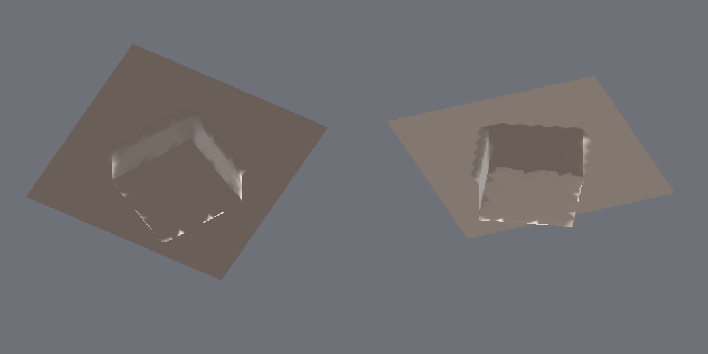
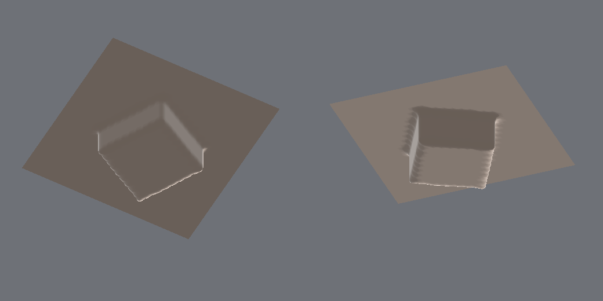
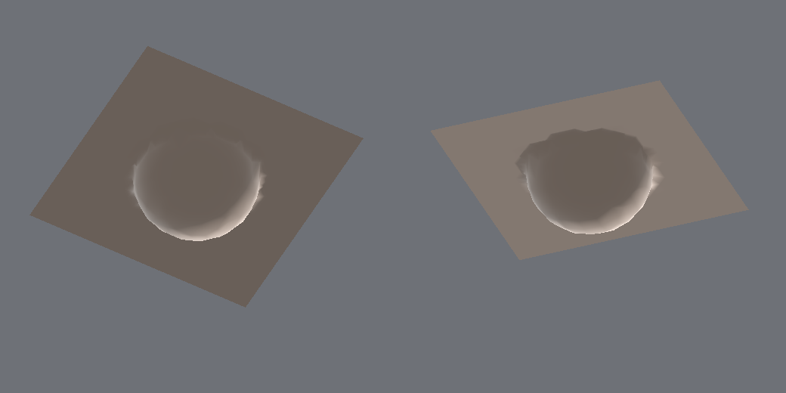
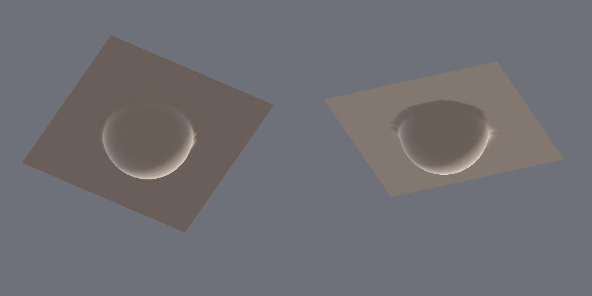
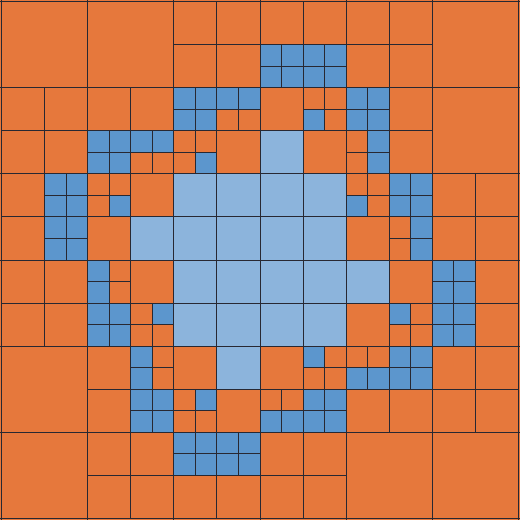
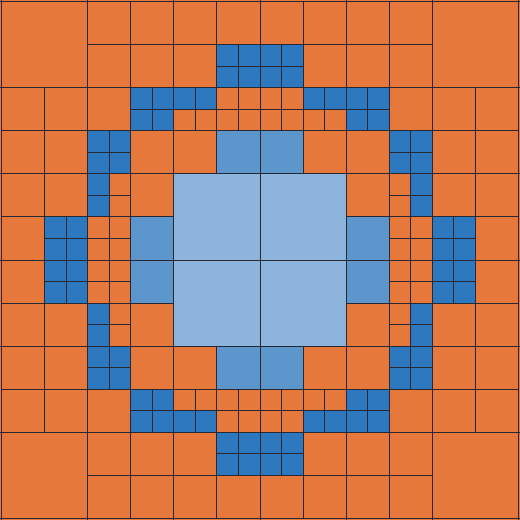
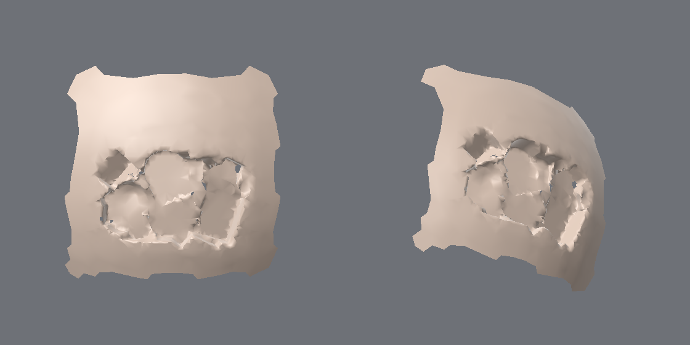

# Spike 6: Adaptively Sampled Distance Field (ADF) boolean

Code: `crates/sculpt-core/src/generator/adf.rs` (spike, not wired into `Document`), tests in
`crates/sculpt-core/tests/adf.rs`, benchmark `sculpt-cli adf-bench`. Context: `DESIGN.md`,
`spike_results.md` (A = displacement boolean, B = uniform sparse bricks + surface nets).

## TL;DR

* **An adaptive tree does what uniform bricks could not: cold build of the true boolean in seconds,
  not minutes.** 6.3M faces, 100k instances: **14.7 s** (smooth sphere) / **26 s** (sphere with
  edge-scale relief) against **113-298 s** for B. 10k instances at 6.3M faces: **4.0 s** / 9.4 s
  against 51-75 s. 1k instances: 0.5-0.6 s against 6-7 s. Cell count is 12.5M against 733M voxels
  (0.5e) at the largest case; memory 0.6 GB against 4.2 GB.
* **It is incremental, which B never was.** Editing 1% of the instances re-adapts only the touched
  blocks: **2-5 ms (1k), 20-170 ms (10k)** for re-adaptation, plus 1-50 ms to re-extract just those blocks.
  Changing *every* instance (a slider drag) is **not interactive** beyond about 1k instances: 28-185 ms
  at 1k, 0.1-1.2 s at 10k, 0.6-7.7 s at 100k, plus roughly the same again for extraction. A (4-80 ms at 10k) stays
  the live evaluator for sliders.
* **Sharp features are right.** Dual contouring with Hermite data puts cube-cutter corners within
  0.005 edge lengths of the exact corner at tolerance 0.5e and finer. Uniform surface nets cut those corners by
  0.33e (voxel 0.5e), 0.76e (1e), 1.44e (2e). Vertex deviation from the exact boolean is <= 0.29e at
  tolerance 0.5e.
* **Caveats that matter:** about 1% of quads touch a cell without a vertex at level crossings (half are
  patched to triangles, half dropped, so tiny holes remain); the patch is an open region with an unstitched boundary
  and adaptive (coarse on flat walls) triangle density, so it is a replacement patch for an explicit commit and not a
  live per-vertex layer; the cached base ADF is the dominant cold cost on detailed meshes (up to 70%).
* **Recommendation:** keep A as the live evaluator, **replace B with the ADF** for "Apply / Convert to
  solid" (and for an exact preview of a few instances being dragged). Details at the end.

## Sources

The papers could not be fetched. The container's network policy blocked `www.merl.com` and
`shadow.merl.com` (`getaddrinfo ENOTFOUND`). A web search returned MERL's record for TR2000-15
(Frisken, Perry, Rockwood, Jones, SIGGRAPH 2000, pp. 249-254, "Adaptively Sampled Distance Fields: A General
Representation of Shape for Computer Graphics", applications: carving of fine detail, volume data) and
TR2001-13 (Pope, Frisken, Perry, "Dynamic Meshing Using Adaptively Sampled Distance Fields"); it returned
nothing for TR2001-08 (Kizamu) or TR2006-054. Everything below about how an ADF works is tagged
**[memory]** (my recollection of the method: octree whose cells store corner distances, subdivided where
trilinear reconstruction misses the true field at test points such as the 19 edge/face/centre points
by more than a tolerance; booleans as min/max of fields with re-adaptation of touched cells) or **[task]** (stated in the task
brief). Design choices that go beyond that are mine and are marked as such.

## What was built

Everything is in `adf.rs`; glue is `InstanceSet::bake_only` / `update_bake_only` (bake without rebuilding
the spike A spatial hash, which an ADF does not use), `pub mod adf;`, and `sculpt-cli adf-bench`.

| Piece | How it works |
|---|---|
| Frame | One root cube. Max depth from `min_cell_edges` (default 0.5 mesh edges). **Blocks** = cells at a fixed depth, about 2 mean instance extents wide; only blocks touched by an instance AABB (+ 2 tol) exist. Blocks are the unit of caching, parallelism and incremental update. |
| Base ADF (cold, cached) | Per block, a top-down error-driven tree of the mesh signed distance (existing `MeshSdf` closest point + pseudo-normal sign from spike B). Each cell evaluates test points (default centre + 6 face centres, `TestPoints::Face7`; `Center` and the paper-style `Full19` also exist) and splits if `|trilinear - field| > tol`, or if it is a surface cell with mixed corner signs. Lattice samples are memoised in a sharded cache keyed by integer lattice coordinates and evaluated at their canonical position, so adjacent blocks share samples and results do not depend on thread order. Built lazily for new blocks; `BaseAdf::clear` on a mesh change (finer invalidation by AABB is easy but not implemented). |
| Boolean ADF | Per block, a second tree of `f = combine(base ADF, instance SDFs)`: subtract `max(b, -min d)`, add `min(b, min d)`, intersect `max(b, min d)`. Candidate instances are filtered down the recursion by AABB distance `< cell diagonal + tol`, which provably leaves the surface and the sign of `f` unchanged. Anti-aliasing guard (mine): a surface cell larger than a nearby instance is always split, otherwise a small cutter can fall between the test points. |
| Incremental update | `update(changes)`: re-bake the changed instances, move them between the per-block instance lists, rebuild only blocks whose list changed (old and new AABB), build base blocks for newly touched blocks. If more than 25% of the instances change, lists are regrouped from scratch (faster than per-instance edits). Test `incremental_equals_full_rebuild` asserts the result is bit-identical to a fresh build. |
| Extraction | **Dual contouring on the adaptive octree** (Ju et al. 2002 cellProc/faceProc/edgeProc) **[memory]**, one vertex per leaf from a QEF over Hermite data (mass-point biased, 5% truncated pseudo-inverse via Jacobi, clamped to the cell). Edge crossings are refined 3 steps on the *real* combined field, normals come from the active term (analytic for instances, trilinear gradient for the base), so concave and convex creases get their own planes. Octree DC is crack-free across levels by construction. Restricted to dirty blocks it emits only quads touching them (the replacement patch for an edit). Quad vertices that miss (coarser cell with no sign change): one missing is replaced by its neighbour (triangle), two or more drop the quad. |
| Reference | `uniform_surface_nets`: dense-grid naive surface nets with the same quad logic as spike B (centroid of edge crossings), used for the sharpness comparison. |

Why dual contouring: with the sign-changing-edge Hermite data already available (exact gradients for the
instance term), DC gets exact sharp features for free, handles octree level changes without a stitching
pass, and its vertex-per-cell form makes "only these blocks" extraction natural. Surface nets (B's choice) cannot
represent a sharp edge inside a cell. Marching cubes variants need a separate crack fix at level changes.

### Tests (`crates/sculpt-core/tests/adf.rs`, 9 tests, all pass)

Adaptive sampling converges to the exact SDF (error <= 2 tol and shrinks with tol); sphere cutter in a plane
within tolerance at 1, 0.5, 0.25 edges (vertices <= tol, facet interiors <= 2 tol); cube cutter keeps
vertical concave edges within 0.6 edge lengths and stays within tol; result oriented outward;
patch interior is watertight (0 open and 0 non-manifold of 867 interior edges); incremental equals full
rebuild (few and many changed instances) and dirty-only extraction is a subset of the full mesh; Add and
Intersect match the analytic fields; a cutter much smaller than a coarse cell is not missed.

## Commands

```
cd sculpt
cargo build --release --workspace
cargo test  --release --workspace
cargo clippy --release --workspace --all-targets            # 0 new warnings (1 old one in tests/engine.rs)
S=./target/release/sculpt-cli
$S adf-bench perf 7,8,9,10 1000,10000,100000 --tol=0.5                  # smooth sphere tables
$S adf-bench perf 9 10000 --tol=2,1,0.5,0.25                            # tolerance sweep
$S adf-bench perf 7,8,9,10 1000,10000,100000 --tol=0.5 --detail=3,10    # relief 3 edges high, 10 edges long
$S adf-bench quality docs/generator/img --images                        # deviation + sharpness + images
$S adf-bench demo docs/generator/img                                    # patch picture
$S adf-bench qcost 9                                                    # mesh query cost vs distance
```
Other flags: `--test=center|face7|full19`, `--block=2` (block width in instance extents), `--op=sub|add|int`.

## Method

* Same meshes as spike A and B: `quad_sphere` + Catmull-Clark, levels 7-10 = 98,304 / 393,216 / 1,572,864 /
  6,291,456 faces. Same instance generator (mask-weighted surface sampler, spheres of 3-10 mesh edge diameters on the surface).
* Tolerance 0.5 mesh edge lengths (e), smallest cell 0.5e (B's finest voxel was also 0.5e), Subtract.
* **Smooth** = the plain sphere. **Relief** = fbm noise displaced along the normal *after* subdivision, amplitude
  up to +-3 edges (typically +-1), wavelength about 10 edges, so the mesh has real edge-scale curvature. Both are reported because a smooth sphere flatters any adaptive
  structure; the relief mesh is closer to a sculpt but still milder than a fully detailed one.
* "Cold" = instance bake + block membership + base ADF (mesh queries) + boolean ADF (incl. Hermite/QEF vertices).
  "Warm" = base ADF cached, boolean ADF rebuilt. "Edit ALL" = every instance scaled x1.1 (a slider drag),
  median of 3 alternating edits. "Edit 1%" = 1% of the instances scaled x1.3, median of 4. "Extract" for edits is
  the dirty-block replacement patch only. Full extraction is listed separately.
* 4 cores, shared container, one process per table; expect +-30% between runs (the same configuration measured
  adapt 530 ms and 850 ms in two runs). Order of magnitude is the finding.

## Results: smooth sphere (ms, tol 0.5e)

Cold build, full extraction, sizes:

| Faces | N | base ADF | boolean adapt | **cold total** | full extract | tris out | blocks / base cells / cells | surface cells | ADF MB |
|---|---|---|---|---|---|---|---|---|---|
| 98,304 | 1k | 23 | 37 | **60** | 27 | 88,829 | 1,131 / 1,471 / 136,667 | 44,365 | 6 |
| 98,304 | 10k | 24 | 119 | **148** | 29 | 88,481 | 1,001 / 1,751 / 271,633 | 44,125 | 13 |
| 98,304 | 100k | 22 | 530 | **572** | 16 | 46,387 | 878 / 1,871 / 132,334 | 23,199 | 24 |
| 393,216 | 1k | 76 | 42 | **119** | 43 | 136,316 | 3,214 / 3,876 / 206,726 | 72,158 | 10 |
| 393,216 | 10k | 158 | 399 | **560** | 232 | 564,398 | 4,802 / 6,986 / 955,642 | 281,192 | 44 |
| 393,216 | 100k | 167 | 1,031 | **1,222** | 110 | 223,177 | 4,179 / 7,952 / 862,899 | 111,525 | 54 |
| 1,572,864 | 1k | 160 | 67 | **229** | 124 | 145,316 | 4,353 / 5,109 / 232,105 | 83,098 | 11 |
| 1,572,864 | 10k | 717 | 592 | **1,314** | 459 | 1,158,877 | 18,199 / 23,427 / 1,736,839 | 582,613 | 80 |
| 1,572,864 | 100k | 1,029 | 2,720 | **3,773** | 967 | 1,981,892 | 19,262 / 31,113 / 4,842,958 | 986,816 | 226 |
| 6,291,456 | 1k | 371 | 141 | **513** | 78 | 148,362 | 4,659 / 5,477 / 239,795 | 86,180 | 11 |
| 6,291,456 | 10k | 2,797 | 1,141 | **3,953** | 1,164 | 1,447,974 | 38,677 / 46,120 / 2,244,869 | 791,973 | 104 |
| 6,291,456 | 100k | 6,365 | 8,301 | **14,717** | 4,443 | 7,916,692 | 80,117 / 111,875 / 12,530,957 | 3,948,702 | 574 |

(At 98k faces and 100k instances every vertex lies in about 57 instances, a stress test of overlap: the
cutters eat most of the surface, which is why the output shrinks.)

Edits (ms). "Warm" is a full re-adapt from scratch with the base cached.

| Faces | N | warm rebuild | **Edit ALL**: update+adapt | Edit ALL: extract | **Edit 1%**: update+adapt | Edit 1%: extract |
|---|---|---|---|---|---|---|
| 98,304 | 1k | 35 | 28 | 25 | **1.8** | 1.9 |
| 98,304 | 10k | 118 | 108 | 27 | **60** | 17 |
| 98,304 | 100k | 585 | 601 | 13 | **616** | 17 |
| 393,216 | 1k | 44 | 51 | 43 | **2.1** | 2.4 |
| 393,216 | 10k | 357 | 340 | 215 | **56** | 33 |
| 393,216 | 100k | 1,244 | 1,147 | 111 | **1,098** | 126 |
| 1,572,864 | 1k | 78 | 88 | 69 | **1.7** | 1.3 |
| 1,572,864 | 10k | 474 | 547 | 490 | **27** | 26 |
| 1,572,864 | 100k | 2,665 | 3,076 | 965 | **1,015** | 469 |
| 6,291,456 | 1k | 114 | 148 | 89 | **3.1** | 1.6 |
| 6,291,456 | 10k | 1,229 | 1,034 | 839 | **30** | 19.6 |
| 6,291,456 | 100k | 7,164 | 7,715 | 4,915 | **699** | 517 |

Notes:

* **1% edits at 100k instances are not cheap** (0.6-1.1 s) because blocks hold about 40 instances each, so
  a random 1% of instances touches roughly a third of the blocks. Smaller blocks (`--block=1`) did not help: base cost and block count
  grew faster than the dirty fraction fell (1.6M faces, 10k: cold 4.2 s against 2.0 s, 1% edit 40 against 33 ms). Edits that
  are spatially coherent (an artist moving a few instances, or a localized mask change) touch far fewer blocks than the random 1% measured here.
* Cell counts follow surface complexity: 6.3M faces at 10k instances needs 2.2M cells in 38.7k blocks; the
  same configuration as 0.5e voxels is 160M samples in 312k bricks (spike B).
* Output triangles (1.4M at 10k) are adaptive: coarse on flat cutter walls, fine at creases and curvature.

## Results: tolerance sweep (1.57M faces, 10k instances, smooth)

| tol (edges) | cold total | cells | boolean adapt (warm) | Edit ALL: update+adapt | Edit ALL: extract | Edit 1% | tris | ADF MB |
|---|---|---|---|---|---|---|---|---|
| 2 | 2,208 | 928,731 | 471 | 596 | 326 | 44 + 36 | 566,771 | 45 |
| 1 | 1,810 | 893,933 | 514 | 577 | 301 | 40 + 28 | 585,344 | 43 |
| 0.5 | 2,286 | 1,736,839 | 1,087 | 1,002 | 716 | 33 + 24 | 1,158,877 | 80 |
| 0.25 | 2,634 | 4,566,347 | 2,045 | 2,213 | 1,611 | 84 + 69 | 2,688,239 | 202 |

(The cold column here includes a 0.9-1.7 s base ADF whose cost is nearly constant; this table was a separate
process with the same code except for the later missing-vertex patch.) Doubling the tolerance from 0.5 to 1 halves the cells and
the edit cost. Beyond 1e the cost is floored by the 0.5e minimum cell on the creases, and by the small-instance guard.
`Center`-only test points make the adaptation 3-4x cheaper (409k against 1.4M cells) but are unsafe, see failure modes.

## Results: relief mesh (ms, tol 0.5e, relief +-3 edges, wavelength 10 edges)

| Faces | N | base ADF | boolean adapt | **cold total** | full extract | tris out | base cells / cells | ADF MB | warm | Edit ALL upd+adapt / extract | Edit 1% upd+adapt / extract |
|---|---|---|---|---|---|---|---|---|---|---|---|
| 98,304 | 1k | 296 | 92 | **389** | 47 | 96,126 | 29,533 / 149,432 | 8 | 127 | 107 / 56 | 5.4 / 2.1 |
| 98,304 | 10k | 350 | 344 | **698** | 67 | 87,113 | 29,733 / 284,997 | 15 | 340 | 319 / 58 | 169 / 36 |
| 98,304 | 100k | 364 | 1,279 | **1,696** | 26 | 35,810 | 29,859 / 125,424 | 24 | 1,320 | 1,333 / 30 | 1,509 / 32 |
| 393,216 | 1k | 1,055 | 148 | **1,205** | 80 | 151,820 | 77,026 / 233,962 | 13 | 132 | 148 / 74 | 2.2 / 1.3 |
| 393,216 | 10k | 1,403 | 785 | **2,192** | 388 | 576,194 | 113,122 / 982,518 | 49 | 667 | 754 / 299 | 113 / 47 |
| 393,216 | 100k | 1,551 | 2,403 | **3,995** | 219 | 227,377 | 114,476 / 884,186 | 59 | 2,536 | 2,365 / 165 | 1,945 / 216 |
| 1,572,864 | 1k | 1,602 | 164 | **1,767** | 111 | 164,581 | 104,479 / 267,802 | 16 | 195 | 184 / 85 | 1.8 / 1.0 |
| 1,572,864 | 10k | 6,812 | 1,109 | **7,925** | 694 | 1,196,858 | 425,125 / 1,821,815 | 98 | 1,157 | 1,231 / 706 | 53 / 33 |
| 1,572,864 | 100k | 7,582 | 4,455 | **12,082** | 1,361 | 1,943,797 | 453,466 / 4,861,465 | 241 | 4,810 | 4,966 / 1,481 | 1,355 / 541 |
| 6,291,456 | 1k | 555 | 61 | **617** | 45 | 163,845 | 107,977 / 272,561 | 16 | 59 | 73 / 43 | 1.4 / 1.2 |
| 6,291,456 | 10k | 7,966 | 1,384 | **9,355** | 874 | 1,590,974 | 916,084 / 2,517,584 | 147 | 1,494 | 1,185 / 758 | 21 / 14 |
| 6,291,456 | 100k | 18,043 | 8,264 | **26,343** | 4,232 | 7,884,997 | 1,784,598 / 12,652,695 | 639 | 7,978 | 6,404 / 3,961 | 570 / 476 |

With edge-scale detail the **base ADF becomes 2/3 of the cold cost at the large sizes** (18 of 26 s at 6.3M
faces, 100k instances) while the boolean part is unchanged. Base blocks are cached across parameter changes, so this is paid once per
mesh edit, not per slider drag. The base cost is the existing closest-point code, which costs 2.7 us on the
surface but grows with distance from it (coarse cell corners are many edges away):

| point offset from surface | 0 | 1 | 4 | 8 | 16 edges |
|---|---|---|---|---|---|
| us per signed-distance query (1 thread, 1.6M faces) | 2.7 | 3.8 | 6.7 | 8.2 | 11.8 |

(Inside the threaded build the measured cost per query was 3-5x higher than these single-thread figures, which suggests
memory-bandwidth or cache pressure on this host; not investigated.) A mesh-to-ADF built from triangles (rasterize, as in
OpenVDB-style conversion) would avoid the far-surface queries; not done.

## Quality: deviation from the exact analytic boolean

Edge unit e = 0.01. Scenes: a **sphere cutter** (r = 12e, centred on the plane y = 0) and a **cube cutter** (half
size 10e, rotated 0.5 rad about y, centred on the plane, producing 4 concave vertical edges, 4 concave floor edges, 4 convex rim edges and
8 corners), both subtracted from an analytic half-space so the reference is exact. "ADF + DC" is this spike. "uniform nets" is the same field on a dense
lattice with naive surface nets (the uniform-brick approach of spike B, producing real triangles). All deviations in units of e.

* *vertex* = |exact field| at extracted vertices; *facet* = at facet centroids and edge midpoints (includes chord error);
* *feature miss* = distance from points sampled along the exact sharp edges (rim, floor, vertical; 20 per edge) to the nearest **triangle** of
  the extracted surface (0 = the edge lies on the surface, a rounded corner scores the amount it was cut);
* *corner miss* = the same for the 8 exact corner points.

| scene | method | tol or voxel | vertex max | vertex mean | facet max | feature miss max | feature miss mean | corner miss max | tris | cells or voxels |
|---|---|---|---|---|---|---|---|---|---|---|
| sphere | ADF + DC | 1e | 0.676 | 0.098 | 1.090 | 0.484 | 0.484 | n/a | 298 | 356 |
| sphere | ADF + DC | 0.5e | 0.291 | 0.047 | 0.196 | 0.118 | 0.118 | n/a | 714 | 804 |
| sphere | ADF + DC | 0.25e | 0.291 | 0.024 | 0.196 | 0.029 | 0.029 | n/a | 1,450 | 1,732 |
| sphere | uniform nets | 2e voxel | 0.556 | 0.049 | 0.560 | 0.690 | 0.690 | n/a | 1,600 | 17,576 |
| sphere | uniform nets | 1e voxel | 0.333 | 0.011 | 0.356 | 0.343 | 0.343 | n/a | 6,458 | 132,651 |
| sphere | uniform nets | 0.5e voxel | 0.200 | 0.003 | 0.188 | 0.174 | 0.174 | n/a | 26,570 | 1,030,301 |
| cube | ADF + DC | 1e | 0.153 | 0.011 | 0.188 | 0.326 | 0.136 | 0.326 | 410 | 676 |
| cube | ADF + DC | 0.5e | 0.153 | 0.009 | 0.187 | 0.320 | 0.113 | **0.005** | 918 | 1,476 |
| cube | ADF + DC | 0.25e | 0.153 | 0.001 | 0.326 | 0.465 | 0.018 | **0.005** | 2,458 | 3,716 |
| cube | uniform nets | 2e voxel | 0.687 | 0.057 | 0.829 | 1.440 | 0.852 | 1.440 | 1,712 | 17,576 |
| cube | uniform nets | 1e voxel | 0.400 | 0.015 | 0.448 | 0.762 | 0.494 | 0.762 | 6,746 | 132,651 |
| cube | uniform nets | 0.5e voxel | 0.200 | 0.004 | 0.209 | 0.328 | 0.210 | 0.328 | 27,962 | 1,030,301 |

Reading it:

* ADF vertices and facets are within the requested tolerance at all three settings (the 1e row's 1.09e facet
  maximum is chord error between two vertices on a coarse sphere facet). On the sphere the ADF at tol 1e is about as accurate as a 2e-voxel net
  (vertex 0.68e against 0.56e, facet 1.09e against 0.56e, so slightly worse) at 1/50 the cells and 1/5 the triangles; at tol 0.5e it is better than that net
  (0.29e / 0.20e) at 1/22 the cells.
* **Corners.** DC places corners exactly (0.005e). Uniform nets cut them by 0.33e-1.44e, 65x-290x worse, and
  do not converge to a sharp corner as the voxel shrinks (halving the voxel halves the error).
* Residual "feature miss max" 0.32-0.47e for the cube is the worst of the sampled *edge points*, not corners: on the
  rim and floor edges the mean miss is 0.02-0.11e and the maxima sit where an edge passes the quad with a vertexless coarse neighbour
  (the patched/dropped quads below) or where clamping a QEF solution to its cell shifts the vertex. I did not isolate which.
* The images use the renderer's smooth vertex normals, so DC's one-vertex-on-the-crease looks jagged under averaged
  normals (the geometry numbers above are the faithful measure; the uniform result looks smoother because it is rounded).

Images (`docs/generator/img/`), left to right per row = two views:

| ADF + DC, tol 0.5e | uniform nets, voxel 1e |
|---|---|
|  |  |
|  |  |

Cell structure on a slice through the cavity (orange = leaf with a surface vertex, blue = cells refined near the creases;
cell size is visible by square size; the coarse orange cells are planar walls and floor):

 

60 mixed cutters (7 primitives, non-uniform scale) into a level-7 sphere, 23 ms cold, 4k triangles (small dark holes are
quads dropped for a vertexless cell, see failure modes):



## Failure modes

* **Quads lost at level crossings.** About 1% of quads (e.g. 8.7k of 695k at 1.6M faces, 10k instances) touch a coarser
  cell whose corners share a sign although the finer neighbour's edge crosses. One missing vertex is patched (a triangle), two drop the
  quad, so roughly 0.5% of the surface is a small hole. A 2:1 balance across cells and blocks, or computing a vertex for such cells from the
  neighbour's Hermite data, would remove this. Interior watertightness in the controlled test scene is perfect (0 open edges); the holes
  appear in dense scenes.
* **Sparse test points alias.** `Center`-only test points miss cutters that sit between samples (a coarse cube cutter collapses
  to 2 triangles at tol 1e, and the sphere row loses detail). The default centre+6 faces plus the small-instance guard is safe on the scenes measured; the guard costs
  about 25% more cells. Features narrower than the test-point spacing and larger than any instance (a thin lip left between two cutters) can still alias, which is the
  usual ADF weakness.
* **Open patch boundary.** The result covers only touched blocks and ends at block faces. Joining it to the untouched mesh
  (cracks, T-junctions, different density) is unsolved, as in spike B.
* **Output density is adaptive, not the sculpt's.** Walls are single large quads; the original sculpt detail (vertex
  density, layers) is re-sampled at the ADF tolerance, i.e. fine sculpt detail below 0.5e is lost in the patch.
* **Sign from pseudo-normals** (inherited from B): fails on non-watertight, self-intersecting or open sculpts.
* **Base ADF cold cost** on detailed meshes (see above) and its **memory** (a 4 GB peak process at 6.3M faces is mostly the document and
  the closest-point structure, not the ADF: ADF-only 0.6 GB).
* **Many instances per block** make edits to a random 1% of 100k instances touch about a third of the blocks (0.6-1.5 s). 
  Dirty-block granularity is the lever; I did not build sub-block dirtiness.
* **Frame is fixed.** Instances moving outside the root cube need a rebuild. Instance AABBs are padded by 2 tol.
* **Non-uniform scale** uses the spike-A lower-bound SDF: the per-cell culling proof then allows a kink *deep inside* the solid (never
  on the surface); not exercised by the tests, and the benchmarks use uniform spheres. Intersect here means "base inside the union of instances" within touched blocks only; the
  semantics for the real layer are undecided.
* **QEF** with normals from trilinear gradients of large base cells is slightly noisy on smooth areas (sub-1% of a cell). The
  clamp to the cell can shift a vertex from a feature that lies outside its own leaf.
* Measured on 4 shared cores, one run per configuration, +-30% run-to-run. Instance counts above are uniform on the surface; real edge damage clusters, which helps (fewer
  blocks and fewer overlaps).

## Topology and the commit story (reasoning only)

What an ADF boolean produces is a new triangle patch (0.09-8M triangles in the tables) over a set of blocks. Layers, masks, freeze and undo are indexed by per-vertex
id and BVH leaf range, so it can only be an **explicit commit that replaces the base in the touched leaves**, the same conclusion as B. The ADF changes what the commit costs
and how crisp it is, not that.

1. **Patch to dense mesh.** The patch has adaptive density. To be a sculpt mesh again it must be re-densified to the working edge length, either by
   subdividing the patch (Catmull-Clark needs quads: DC emits quads, so keep them and only split the diagonal for display) or by a quad remesh, then
   projected back onto the ADF surface. The projection is cheap with an ADF: distance and gradient come from the cached trees, about 3 field evaluations per vertex (~1 us).
2. **Resampling the per-vertex layer data** (this is the transfer asked about): for every new vertex, find the nearest point on the *pre-boolean* surface
   (closest-point query against the old mesh BVH, the same code used for the base ADF) and interpolate each channel with the
   barycentric weights. Cost per new vertex = one closest-point query. Measured here: 2.7 us on the surface, 4-7 us a few
   edges away (cavity floors and walls are 1-10 edges from the old surface), so about 3-6 us per vertex; on 4 cores that is **0.5-1.5 us per vertex**
   effective: **0.6M new vertices about 1 s, 4M about 4-6 s, 16M about 15-25 s**, plus another 0.2-0.5 us per vertex and layer
   for the weighted gather. Layer deltas should be zeroed (or faded) where the nearest-source distance exceeds the tolerance, since the surface there is new geometry and
   carrying old displacement across the wall would smear it. Masks, paint and freeze can keep the nearest value (rim values smeared down the wall).
3. **Stitching** the patch boundary to the untouched mesh and rebuilding BVH leaf ranges and normals for the replaced leaves. Not measured. Best handled
   by extending the patch to whole BVH leaves and welding its boundary ring to the leaf's boundary vertices, or by Boolean-ing against only the leaf's faces.
   The closest-point structure for the whole 6.3M-face mesh is 0.54 s / 252 MB (spike B), so rebuilding it for affected leaves is small next to the above.
4. **Undo** = snapshot of the replaced leaves (positions, layer chunks, channels) plus the instance parameters; not per-vertex.
5. **Base invalidation** when the mesh below changes: blocks overlapping the dirty box are rebuilt (about 100-300 us of CPU per smooth base block in these runs; a brush dab touching
   a few dozen blocks would be a few ms), after which the boolean tree of those blocks is re-adapted. Not implemented, only estimated.

Total for a commit on a 1.6M-face mesh with 10k instances: boolean cold 1.3-8 s (smooth, relief) + re-densify and resample about 2-5 s + stitching, i.e. a **background job of
about 5-15 s**, against B's 28-54 s cold for the boolean alone at that size.

## Recommendation

| | A (displacement) | B (uniform bricks) | **ADF (this spike)** |
|---|---|---|---|
| Cold, 1.6M faces / 10k inst. | none | 27-54 s | **1.3 s smooth, 7.9 s relief** |
| Cold, 6.3M faces / 100k inst. | none | 113-298 s | **14.7 s smooth, 26 s relief** |
| Slider drag, every instance changes | **4-34 ms (10k, up to 1.6M)**, 58 ms at 6.3M | 0.18-2.5 s (10k), cache assumed free | 0.1-1.2 s (10k) + 0.03-0.9 s extraction |
| Edit 1% of instances | 7-14 ms (10k) | no incremental | **20-170 ms (10k) + 14-50 ms**, 2-5 ms at 1k |
| Corner sharpness | soft (mesh density) | rounded (0.3-1.4e) | **exact (0.005e)** |
| Overhangs, thin walls, true Add/Intersect | no | yes | **yes** |
| Memory, largest case | ~75 MB deltas | 4.2 GB | **0.6 GB** |
| Topology / layers / undo | **kept** | change | change (explicit commit) |

1. **Keep A as the live layer evaluator**; it is 10-100x faster for slider drags and keeps the layer model.
2. **Use the ADF instead of B for "Apply / Convert to solid"**: 4-40x faster cold, 7x less memory, crisp corners, tolerance as a quality slider
   (1e for a quick commit, 0.5e or 0.25e for a final one). With the tolerance sweep above, a 10k-instance commit at 1.6M faces is 1.8-2.6 s of boolean.
3. **Add an exact preview for direct manipulation**: with the ADF warm, dragging or resizing a handful of instances costs about 2-5 ms to re-adapt (1k) and 30-170 ms (10k), plus 1-50 ms
   of extraction of just the dirty blocks. That is interactive for "move this one cutter" but not for a global slider, which should stay on A (and on A's cheap coarse mode while the ADF refines in the background).
4. Before committing to it: fix the lost quads (balance or neighbour vertices), build the base ADF from triangles (70% of cold cost on detailed meshes),
   add per-leaf base invalidation, and solve patch stitching and re-densification, which this spike did not touch and which decide the commit's real cost.
